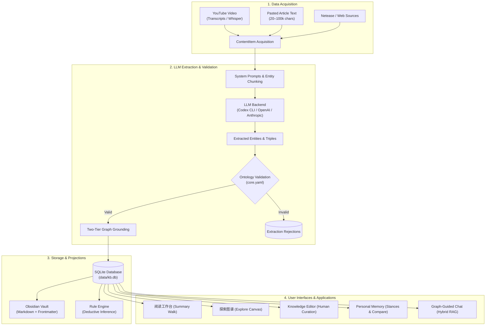

# OntoKB v2: Schema-Governed Personal Knowledge Graph & Semantic Memory Agent

[](https://www.python.org/downloads/)
[](https://schema.org/)
[](https://www.sqlite.org/)
[](tests/)
[](LICENSE)
[](README_zh.md)

> **OntoKB** is a schema-governed, evidence-grounded personal knowledge graph and semantic memory agent. It bridges the gap between Large Language Models (LLMs) and Formal Knowledge Representation by enforcing closed-world Schema.org ontology profiles, mandatory verbatim evidence quote anchoring, two-tier graph grounding, and strict separation between objective source claims and subjective human beliefs.
>
> *(For the upstream original Chinese documentation, see [README_zh.md](README_zh.md).)*

---

## Table of Contents

1. [Architectural Thesis: Why OntoKB?](#1-architectural-thesis-why-ontokb)
2. [High-Level System Architecture](#2-high-level-system-architecture)
3. [Deep-Dive Module Breakdown](#3-deep-dive-module-breakdown)
   - [3.1 Ontology Governance Subsystem](#31-ontology-governance-subsystem)
   - [3.2 Graph Storage & Normalization Engine](#32-graph-storage--normalization-engine)
   - [3.3 Extraction & Grounding Pipeline](#33-extraction--grounding-pipeline)
   - [3.4 Multimodal Content Acquisition](#34-multimodal-content-acquisition)
   - [3.5 Dual-Mode Interactive Visualization](#35-dual-mode-interactive-visualization)
   - [3.6 Transactional Knowledge Editor](#36-transactional-knowledge-editor)
   - [3.7 Epistemic Personal Memory & Stance System](#37-epistemic-personal-memory--stance-system)
   - [3.8 Graph-Guided Chat & Hybrid RAG](#38-graph-guided-chat--hybrid-rag)
   - [3.9 Obsidian Vault Bi-directional Projection](#39-obsidian-vault-bi-directional-projection)
   - [3.10 Deductive Rule Engine](#310-deductive-rule-engine)
4. [REST API Reference](#4-rest-api-reference)
5. [CLI Commands Reference](#5-cli-commands-reference)
6. [Configuration Guide](#6-configuration-guide)
7. [Installation & Quickstart](#7-installation--quickstart)
8. [Comprehensive Documentation Library](#8-comprehensive-documentation-library)
9. [Troubleshooting & Frequently Asked Questions](#9-troubleshooting--frequently-asked-questions)

---

## 1. Architectural Thesis: Why OntoKB?

Traditional Knowledge Graphs and generative AI applications suffer from four foundational failure modes:

| Failure Mode in Naive AI / RAG | How OntoKB Solves It |
| :--- | :--- |
| **Hallucinated Node Types & Predicates** | Enforces a closed-world Schema.org profile (`ontology/core.yaml`). Ingestions violating domain/range constraints are rejected. |
| **Ungrounded, Floating Facts** | Implements **Two-Tier Grounding**: every extracted factual triple must link directly to an ingested document node and include a verbatim text quote. |
| **Epistemic Pollution** | Decouples objective source claims from subjective personal beliefs. The **Personal Memory** tier allows users to review, accept, question, or refute assertions without corrupting the historical source record. |
| **Destructive Automated Overwrites** | Human edits in the Knowledge Editor are flagged with provenance immunity (`manual_entities`, `manual_triples`), preventing automated extraction runs from undoing human curation. |

---

## 2. High-Level System Architecture



---

## 3. Deep-Dive Module Breakdown

### 3.1 Ontology Governance Subsystem
- **Files**: `ontology/core.yaml`, `src/ontokb/ontology.py`
- **Schema.org Research Profile**:
  - Implements a single-parent inheritance tree rooted at `Thing`:
    - `Person`: Concrete human individuals (excludes AI employees and job titles).
    - `Organization`: Companies, universities, research institutions.
    - `Product`: Physical manufactured goods, hardware accelerators.
    - `SoftwareApplication`: Named software programs, models, frameworks, operating systems.
    - `DefinedTerm`: Scientific concepts, technical mechanisms, categories, theories.
    - `CreativeWork`: Works of authorship, partitioned into `Article`, `Book`, `VideoObject`, `MediaObject`.
    - `Claim`: Verifiable empirical assertions, hypotheses, arguments, or predictions.
- **Relational Domain & Range Constraints**:
  - `worksFor`: `Person` $\to$ `Organization`
  - `develops`: `Organization` $\to$ `[DefinedTerm, SoftwareApplication, Product]`
  - `makes`: `Organization` $\to$ `[Product, SoftwareApplication]`
  - `adopts`: `Organization` $\to$ `[DefinedTerm, SoftwareApplication, Product]`
  - `uses`: `[Product, SoftwareApplication]` $\to$ `[DefinedTerm, SoftwareApplication, Product]`
  - `competesWith`: `Organization` $\to$ `Organization` (Symmetric)
  - `makesClaim`: `[Person, Organization, CreativeWork]` $\to$ `Claim`
  - `supports` / `contradicts`: `Claim` $\to$ `Claim` (Symmetric contradiction)

### 3.2 Graph Storage & Normalization Engine
- **Files**: `src/ontokb/graph.py`, `src/ontokb/models.py`
- **Tables**: `entities`, `aliases`, `triples`, `contents`, `manual_entities`, `manual_triples`, `manual_triple_keys`, `edit_history`, `personal_memory`, `memory_history`.
- **Unicode NFKC Normalization**:
  - All entity names and aliases are normalized via Unicode NFKC, casefolded, and stripped of extraneous whitespace.
  - Implements a Chinese variant mapping table (`_CHINESE_VARIANTS`) handling Traditional/Simplified equivalents (e.g. 达/達, 奥/奧, 权/權, 经/經).
- **Alias Resolution & Conflict Avoidance**:
  - Prevents alias hijacking: An alias cannot be associated with Entity A if it already belongs to Entity B.
  - Type conflicts are resolved via subclassing rules: specific types are never widened to generic `Thing`.

### 3.3 Extraction & Grounding Pipeline
- **Files**: `src/ontokb/pipeline.py`, `src/ontokb/llm.py`, `src/ontokb/codex_backend.py`
- **Two-Tier Grounding**:
  1. **Knowledge Tier**: Real-world factual assertions ($S \xrightarrow{P} O$).
  2. **Document Tier**: Structural provenance edges where the document entity ($D$) links to mentioned entities ($D \xrightarrow{\text{mentions}} E$ and $D \xrightarrow{\text{about}} E$).
- **Evidence Verification**: Every triple requires an verbatim quote snippet directly from the source text and an extraction confidence score ($[0.0, 1.0]$).
- **Automated Backups**: Ingestions with `replace_source=True` automatically create a timestamped backup of the database and vault under `data/backups/`.

### 3.4 Multimodal Content Acquisition
- **Files**: `src/ontokb/sources/youtube.py`, `src/ontokb/sources/netease.py`, `src/ontokb/reading.py`
- **YouTube Pipeline**:
  - Normalizes multiple video URL variants (standard, shortened, shorts, live streams, embeds).
  - Fetches timed subtitles using `youtube-transcript-api` (prioritizing Chinese and English).
  - Falls back gracefully to `yt-dlp` audio downloading and local `whisper` model transcription.
- **Article Intake**:
  - Enforces 20–100,000 character boundaries and HTTP/HTTPS source URL format.
  - Generates deterministic hash IDs: `article:` + SHA256(`title` + `\0` + `url` + `\0` + `text`)[:24].

### 3.5 Dual-Mode Interactive Visualization
- **Files**: `src/ontokb/visualize.py`, `src/ontokb/web/reading.html`, `src/ontokb/web/reading.js`, `src/ontokb/web/reading.css`
- **Mode 1: Guided Summary Walking (`阅读工作台`)**:
  - Breaks down article summaries into sentence-by-sentence reading steps.
  - Matches entities mentioned in each sentence using exact and alias lookup.
  - Dynamically highlights active step entities and their 1-hop neighborhood while dimming all other nodes to `opacity: 0.09`.
  - Supports automated step playback (6s, 10s, 15s speed controls) with smooth SVG camera panning.
- **Mode 2: Global Graph Exploration (`探索图谱`)**:
  - Renders the full interactive network in D3 force-directed layout.
  - Node color coding mapped to Schema.org types (`Organization`: Sage, `Person`: Ochre, `DefinedTerm`: Slate Teal, `SoftwareApplication`: Soft Purple, `Claim`: Gold, `Product`: Coral).
  - Multi-tier filtering by layer (`Core`, `Claims`, `Documents`, `All`) and by specific entity type.

### 3.6 Transactional Knowledge Editor
- **Files**: `src/ontokb/editing.py`, `src/ontokb/web/editor.js`, `src/ontokb/web/editor.css`
- **Human Provenance Immunity**: Any manual change to an entity or triple is permanently recorded in `manual_entities` and `manual_triples`. Future automated LLM runs cannot overwrite these human decisions.
- **Mutation Operations**:
  - Rename entities (auto-updates all incident triples).
  - Add / delete aliases.
  - Reclassify entity types (validates that incident edges still satisfy ontology rules).
  - Mutate relation predicates, endpoints, and evidence quotes.
- **Undo Journal**: Appends every state transition to `edit_history` with full before/after JSON snapshots, enabling atomic rollbacks.

### 3.7 Epistemic Personal Memory & Stance System
- **Files**: `src/ontokb/memory.py`, `src/ontokb/web/memory.js`, `src/ontokb/web/memory.css`
- **Epistemic Separation**: Objective extracted facts remain immutable in `triples`; personal opinions are recorded in `personal_memory`.
- **Review Dimensions**:
  - `reviewed`: Boolean flag indicating human verification.
  - `included`: Boolean flag indicating inclusion into the user's personal memory core.
  - `stance`: Three-state evaluation: `agree` (accepted truth), `uncertain` (open question), or `disagree` (rejected claim).
  - `note`: User's qualitative rationale.
- **Judgment Comparison (`/api/memory/compare`)**: Uses LLM reasoning to evaluate how an incoming article aligns with, supports, or contradicts historical personal memory stances.

### 3.8 Graph-Guided Chat & Hybrid RAG
- **Files**: `src/ontokb/assistant.py`, `src/ontokb/api.py`, `src/ontokb/chat_history.py`, `src/ontokb/knowledge_agent.py`
- **Entity Discovery**: Length-descending greedy substring extraction discovers CJK and Latin entity mentions in unsegmented user prompts.
- **Graph Expansion**: Conducts 1-hop and 2-hop BFS expansions around matched entities.
- **Evidence-Preserving Prompting**: Generates tabular knowledge context and citation quotes directly in the LLM prompt, enforcing answers grounded strictly in graph evidence.

### 3.9 Obsidian Vault Bi-directional Projection
- **Files**: `src/ontokb/vault.py`
- Projects SQLite graph entities into local Markdown files inside the Obsidian vault (`vault/`).
- Generates structured YAML frontmatter (aliases, type, review status, sources) and formats relationships as clickable `[[Wikilinks]]`.

### 3.10 Deductive Rule Engine
- **Files**: `src/ontokb/rules.py`, `rules/default.yaml`
- Evaluates logical implication rules over existing triples to derive inferred relations and detect semantic contradictions.

---

## 4. REST API Reference

The server runs on `http://127.0.0.1:8765` using an HTTP/1.1 persistent streaming server with `SO_LINGER` socket protection.

| Method | Endpoint | Description | Request Body / Query Params |
| :--- | :--- | :--- | :--- |
| `GET` | `/` | Standalone interactive UI | None (embeds full D3 visualization & reading workspace) |
| `GET` | `/health` | System health & LLM status | None $\to$ `{"ok": true, "llm_provider": "...", "llm_configured": bool}` |
| `GET` | `/api/reading` | Full graph & reading library | Returns all nodes, edges, articles, steps, and neighbor links |
| `GET` | `/api/editor` | Knowledge Editor bootstrap | Returns entities, aliases, triples, and editing options |
| `GET` | `/api/memory` | Personal memory bootstrap | Returns memory records, review history, and sources |
| `GET` | `/api/entities/search` | Search entities | `q`: search query, `mode`: `terms`\|`phrase`, `limit`: int, `expand`: bool |
| `GET` | `/api/graph/query` | Subgraph retrieval | `query`: entity/term query, `mode`: `terms`\|`phrase`, `limit`: int |
| `POST` | `/api/articles` | Ingest new article | `{"title": str, "text": str, "url": str}` |
| `POST` | `/api/reading/category`| Set article category | `{"content_id": str, "category": "科技"|"历史"|"时政"}` |
| `POST` | `/api/chat` | Graph-guided chat query | `{"question": str, "mode": str, "top": int, "expand": bool, "history": list}` |
| `POST` | `/api/editor/entity/rename` | Rename an entity | `{"entity_id": int, "new_name": str, "revision": str}` |
| `POST` | `/api/editor/entity/alias` | Add/remove alias | `{"entity_id": int, "alias": str, "action": "add"|"remove", "revision": str}` |
| `POST` | `/api/editor/entity/type` | Change entity type | `{"entity_id": int, "new_type": str, "revision": str}` |
| `POST` | `/api/editor/entity/delete` | Delete an entity | `{"entity_id": int, "revision": str}` |
| `POST` | `/api/editor/triple/create` | Create new triple | `{"subject": str, "predicate": str, "object": str, "evidence": str}` |
| `POST` | `/api/editor/triple/update` | Update existing triple | `{"triple_id": int, "predicate": str, "evidence": str, "revision": str}` |
| `POST` | `/api/editor/triple/delete` | Delete a triple | `{"triple_id": int, "revision": str}` |
| `POST` | `/api/editor/undo` | Revert last edit | None $\to$ rolls back last entry in `edit_history` |
| `POST` | `/api/memory/review` | Update personal stance | `{"key": str, "revision": int, "reviewed": bool, "included": bool, "stance": str, "note": str}` |
| `POST` | `/api/memory/compare` | Compare document to memory | `{"source_id": str}` $\to$ returns comparative synthesis report |

---

## 5. CLI Commands Reference

OntoKB provides a unified CLI via `python -m ontokb.cli` or the `ontokb` command:

```bash
# 1. Start the HTTP API Server & Web UI
python -m ontokb.cli api --host 127.0.0.1 --port 8765

# 2. Check Database Entity, Triple, and Content Counts
python -m ontokb.cli status

# 3. Ingest a Single URL (YouTube or Web)
python -m ontokb.cli ingest "https://www.youtube.com/watch?v=..."

# 4. Ingest All URLs Configured in Queue / Watchlist
python -m ontokb.cli queue

# 5. Execute Deductive Rule Engine over Graph
python -m ontokb.cli rules

# 6. Backfill Document Tier Links for Pre-Refactor Extractions
python -m ontokb.cli backfill

# 7. Preview or Apply Schema.org Ontology Profile Migration
python -m ontokb.cli migrate-ontology --apply

# 8. Export Graph Store to W3C JSON-LD Format
python -m ontokb.cli export-jsonld --out data/knowledge-graph.jsonld
```

---

## 6. Configuration Guide

System configuration is managed via `config/config.yaml`. A starter template is provided in `config/config.example.yaml`:

```yaml
# config/config.yaml
paths:
  db: data/kb.db                     # SQLite database file location
  vault: vault                       # Obsidian vault projection directory
  transcripts: data/transcripts       # Cached YouTube / Whisper transcripts

llm:
  provider: codex                    # LLM Provider: 'codex', 'openai', or 'anthropic'
  model: gpt-4o                      # Primary extraction model
  fallback_model: gpt-4o-mini        # Low-cost fallback model
  output_language: Simplified Chinese

defaults:
  confidence_threshold: 0.7          # Minimum extraction confidence score
  whisper_language: zh               # Local Whisper speech recognition language

interests:                           # Domain topics prioritized during extraction
  - 人工智能与大模型
  - 知识图谱与本体论
  - 芯片算力与硬件架构
```

---

## 7. Installation & Quickstart

### Prerequisites
- **Python**: Version 3.10, 3.11, 3.12, or 3.13.
- **FFmpeg**: Required if using local Whisper audio transcription for YouTube videos.

### Step 1: Clone & Setup Virtual Environment
```bash
git clone https://github.com/roclive/OntoKB.git
cd OntoKB

# Create virtual environment
python -m venv venv
# Windows:
.\venv\Scripts\Activate.ps1
# Linux / macOS:
source venv/bin/activate

# Install dependencies
pip install -e .
```

### Step 2: Configure Environment
Copy the example configuration:
```bash
cp config/config.example.yaml config/config.yaml
```

Set your LLM credentials (choose one):
```powershell
# Option A: Codex CLI
codex login

# Option B: OpenAI API Key
$env:OPENAI_API_KEY="sk-..."
$env:ONTOKB_LLM_PROVIDER="openai"

# Option C: Anthropic Claude API Key
$env:ANTHROPIC_API_KEY="sk-ant-..."
$env:ONTOKB_LLM_PROVIDER="anthropic"
```

### Step 3: Populate Initial Seed Graph
To immediately explore OntoKB with a pre-seeded, realistic 26-entity, 4-article knowledge graph:
```bash
python scripts/seed_rich_graph.py
```

### Step 4: Launch the Web UI
```bash
python -m ontokb.cli api --host 127.0.0.1 --port 8765
```
Open your browser at **`http://127.0.0.1:8765`**.

### Step 5: Run Automated Tests
Verify your local installation against all 144 unit and integration tests:
```bash
python -m pytest
```

---

## 8. Comprehensive Documentation Library

For exhaustive architectural specifications, flowcharts, and technical deep-dives, consult the specialized documents in the [`docs/`](docs/) directory:

| Document | Word Format (.docx) | Markdown Format (.md) | Focus |
| :--- | :--- | :--- | :--- |
| **01. UI/UX Flow** | [01_UI_UX_FLOW.docx](docs/01_UI_UX_FLOW.docx) | [01_UI_UX_FLOW.md](docs/01_UI_UX_FLOW.md) | Visual breakdown of every button, modal, drawer, and interaction. |
| **02. User Process Flow** | [02_USER_PROCESS_FLOW.docx](docs/02_USER_PROCESS_FLOW.docx) | [02_USER_PROCESS_FLOW.md](docs/02_USER_PROCESS_FLOW.md) | Step-by-step user journey from ingestion to memory review. |
| **03. Tech Stack** | [03_TECH_STACK.docx](docs/03_TECH_STACK.docx) | [03_TECH_STACK.md](docs/03_TECH_STACK.md) | Comprehensive audit of libraries, frameworks, and dependencies. |
| **04. Architecture & API** | [04_SYSTEM_ARCHITECTURE_AND_API.docx](docs/04_SYSTEM_ARCHITECTURE_AND_API.docx) | [04_SYSTEM_ARCHITECTURE_AND_API.md](docs/04_SYSTEM_ARCHITECTURE_AND_API.md) | Core system components, SQLite schema, and REST specifications. |
| **05. Current Features** | [05_CURRENT_FEATURES_DETAILED_ANALYSIS.docx](docs/05_CURRENT_FEATURES_DETAILED_ANALYSIS.docx) | [05_CURRENT_FEATURES_DETAILED_ANALYSIS.md](docs/05_CURRENT_FEATURES_DETAILED_ANALYSIS.md) | Complete capability matrix and module-by-module implementation analysis. |
| **06. Flaws & Limitations** | [06_FLAWS_LIMITATIONS_AND_VULNERABILITIES.docx](docs/06_FLAWS_LIMITATIONS_AND_VULNERABILITIES.docx) | [06_FLAWS_LIMITATIONS_AND_VULNERABILITIES.md](docs/06_FLAWS_LIMITATIONS_AND_VULNERABILITIES.md) | 28 technical flaws, concurrency bottlenecks, and security vulnerabilities. |
| **07. Enterprise Roadmap** | [07_ENTERPRISE_GRADE_TRANSFORMATION_ROADMAP.docx](docs/07_ENTERPRISE_GRADE_TRANSFORMATION_ROADMAP.docx) | [07_ENTERPRISE_GRADE_TRANSFORMATION_ROADMAP.md](docs/07_ENTERPRISE_GRADE_TRANSFORMATION_ROADMAP.md) | Neo4j/Memgraph, Qdrant, Celery, RBAC, and WebGL transformation blueprint. |

---

## 9. Troubleshooting & Frequently Asked Questions

### Q1: Why are all the nodes dimmed to near-invisibility on initial load?
**A**: By default, the interface opens in **`阅读工作台` (Guided Summary Walk)** mode. In this mode, OntoKB focuses solely on the entities and 1-hop neighbors mentioned in the currently active paragraph step, dimming all other nodes to `0.09` opacity. To view the entire graph simultaneously with 100% opacity, click **`探索图谱` (Explore Graph)** in the top navigation bar.

### Q2: Why are articles not displayed as a card list under `YOUR READING SPACE`?
**A**: To conserve screen space for summary walking and graph canvas interactions, OntoKB uses a **compact dropdown selector (`<select>`)** directly below the category filter chips. Click the dropdown to reveal and switch between all ingested articles.

### Q3: Why does article ingestion fail when I only provide a URL?
**A**: OntoKB currently contains automated scraping support **only for YouTube videos** (via subtitles and audio Whisper). For standard web articles, you must copy and paste the text into the `文章正文` field (minimum 20 characters). The URL field is stored as reference metadata for the `阅读原文 ↗` provenance link.

### Q4: Why did large graph loads previously hang on Windows?
**A**: Default Python `BaseHTTPRequestHandler` runs on HTTP/1.0 and closes TCP sockets immediately upon handler return. On Windows, closing a socket with unacknowledged data in the Winsock kernel buffer cuts off transmissions larger than 120 KB (`WinError 10054`). This was resolved in OntoKB v2 by upgrading `GraphApiHandler` to **HTTP/1.1 persistent streaming** with socket `SO_LINGER` protection and explicit stream flushing.

---

## 10. License & Attribution

OntoKB is licensed under the MIT License. Built upon W3C Semantic Web and Schema.org community standards. Designed for verifiable knowledge engineering and personal cognitive enhancement.
