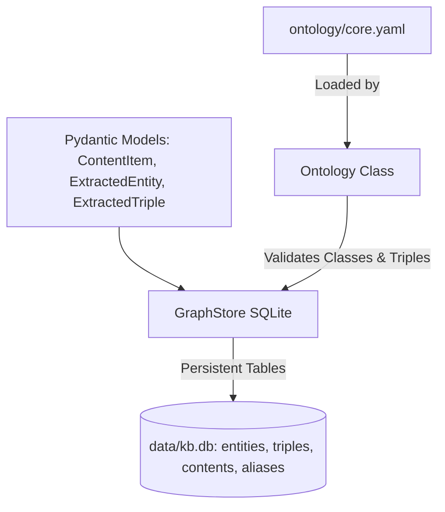

# OntoKB v2: Subsystem 01 — Core Models & Graph Store

**Module Scope**: `src/ontokb/models.py`, `src/ontokb/ontology.py`, `src/ontokb/graph.py`  
**Architectural Layer**: Layer 1 — Core Foundation, Schema Governance & Persistent Storage  
**Dependencies**: Python standard library (`sqlite3`, `unicodedata`, `re`, `json`, `dataclasses`, `pathlib`), `pydantic`, `pyyaml`.

---

## 1. Architectural Overview

The Core Foundation layer is the bedrock of OntoKB v2. It provides:
1. **Strict Type Contracts (`models.py`)**: Pydantic models that define both internal runtime representations and strict JSON Schema targets for LLM structured output decoders.
2. **Schema Governance (`ontology.py`)**: A closed-world Schema.org validation engine that enforces single-parent class inheritance, domain/range type compatibility, and acyclicity.
3. **Persistent Triple Store (`graph.py`)**: An embedded SQLite graph store featuring NFKC text normalization, recursive Chinese variant search expansion, alias resolution, optimistic provenance tracking, and transaction safety.

---

## 2. Module: `src/ontokb/models.py`

### 2.1 File Purpose
Defines strictly typed Pydantic models used across the ingestion pipeline, SQLite storage layer, API serializations, and LLM structured outputs. Special care is taken to avoid open-ended dictionaries in LLM output schemas by using explicit key-value tuples (`Property`), ensuring 100% compliance with OpenAI's strict JSON schema mode.

### 2.2 Classes & Data Structures

#### 1. `ContentItem(BaseModel)`
Represents an item in the ingestion queue before or after raw text acquisition.
* **Fields**:
  - `id: str`: Deterministic identifier (`yt:<video_id>` for YouTube, or `article:<hash>` for text).
  - `kind: Literal["video", "article"]`: Discriminator for content modality.
  - `source: Literal["youtube", "netease", "other"]`: Origin platform discriminator.
  - `url: str`: Full canonical URL of the resource.
  - `title: str = ""`: Document headline or video title.
  - `published_at: Optional[str] = None`: ISO-8601 publication timestamp string.
  - `duration_seconds: Optional[int] = None`: Duration for video media (None for articles).
  - `raw_text: str = ""`: Ingested transcript or scraped article text body.

#### 2. `Property(BaseModel)`
Simple key-value container used to satisfy OpenAI's strict structured outputs schema, which prohibits arbitrary dictionary mappings.
* **Fields**:
  - `key: str`: Property attribute name.
  - `value: str`: Property attribute value.

#### 3. `ExtractedEntity(BaseModel)`
Internal representation of an entity extracted from text by an LLM.
* **Fields**:
  - `name: str`: Canonical entity name.
  - `type: str`: Schema.org class name (`Person`, `Organization`, `DefinedTerm`, `Claim`, etc.).
  - `aliases: list[str]`: Alternative names, abbreviations, or synonyms.
  - `properties: dict[str, str]`: Dynamic dictionary of attributes.

#### 4. `ExtractedTriple(BaseModel)`
Represents a directed, typed semantic relationship between two entities.
* **Fields**:
  - `subject: str`: Subject entity name matching an `ExtractedEntity.name`.
  - `predicate: str`: Ontology relation name (e.g. `worksFor`, `mentions`, `about`).
  - `object: str`: Object entity name matching an `ExtractedEntity.name`.
  - `confidence: float`: Float between `0.0` and `1.0` (default `0.8`).
  - `evidence: str`: Verbatim text snippet from source material supporting this assertion.

#### 5. `ProcessedContent(BaseModel)`
Complete structured representation produced after LLM parsing.
* **Fields**:
  - `content_id: str`: Target document ID.
  - `summary: str`: Dense conceptual summary.
  - `key_points: list[str]`: Ordered takeaways.
  - `topics: list[str]`: Primary topic entity names.
  - `relevance: dict[str, float]`: Relevance scores mapped per configured user interest.
  - `entities: list[ExtractedEntity]`: List of extracted entities.
  - `triples: list[ExtractedTriple]`: List of extracted relationships.

#### 6. `RelevanceScore(BaseModel)`
* **Fields**:
  - `interest: str`: Topic name.
  - `score: float`: Float score constrained between `0.0` and `1.0`.

#### 7. `LLMEntity(BaseModel)`
LLM-facing entity structure using `list[Property]` instead of an open map.
* **Methods**:
  - `to_extracted(self) -> ExtractedEntity`: Unpacks the `properties: list[Property]` pairs into a standard Python `dict[str, str]` and returns an `ExtractedEntity`.

#### 8. `ExtractionResult(BaseModel)`
The exact Pydantic schema handed to the LLM structured output parser (omitting `content_id` which the LLM does not generate).
* **Methods**:
  - `to_processed(self, content_id: str) -> ProcessedContent`: Converts raw LLM output into an internal `ProcessedContent` instance, converting `list[Property]` to dictionaries and `list[RelevanceScore]` to maps.

---

## 3. Module: `src/ontokb/ontology.py`

### 3.1 File Purpose
Parses `ontology/core.yaml`, verifies class hierarchy acyclicity, enforces domain/range restrictions, and provides prompt summaries for LLM extraction context.

### 3.2 Exceptions
* `OntologyError(ValueError)`: Custom exception raised when schema violations, cyclic inheritance, unknown classes, or domain/range mismatches are detected.

### 3.3 Data Structures & Classes

#### 1. `RelationDef` (dataclass)
Specifies constraints for a single relationship predicate.
* **Attributes**:
  - `name: str`: Relation name.
  - `domain: str | list[str]`: Allowed subject entity classes.
  - `range: str | list[str]`: Allowed object entity classes.
  - `symmetric: bool`: Whether the relationship is bidirectional ($A \to B \iff B \to A$).
  - `uri: str`: Schema.org URI (e.g. `https://schema.org/worksFor`).
  - `description: str`: Human-readable description.

#### 2. `Ontology` (dataclass)
The core schema validator.
* **Attributes**:
  - `classes: dict[str, dict]`: Loaded class specifications.
  - `relations: dict[str, RelationDef]`: Loaded relation definitions.
  - `version: int`: Schema version integer.
  - `class_aliases: dict[str, str]`: Compatibility mappings (e.g. `Technology` $\to$ `DefinedTerm`).
  - `relation_aliases: dict[str, str]`: Compatibility mappings (e.g. `worksAt` $\to$ `worksFor`).

* **Methods**:
  - `load(cls, path: str | Path) -> Ontology`:
    - *Purpose*: Reads and parses the YAML ontology specification from disk.
    - *Algorithm*:
      1. Loads YAML using `yaml.safe_load`.
      2. Validates that every class specifies a parent that exists in `classes`.
      3. For every relation, validates that domain and range classes exist in `classes`.
      4. Detects inheritance cycles: for every class, follows parent pointers until `None` or an already-visited class is encountered. If a cycle is detected, raises `OntologyError`.
      5. Validates compatibility aliases to ensure targets exist and aliases do not collide.
    - *Returns*: Fully initialized and verified `Ontology` instance.

  - `canonical_class(self, name: str) -> str`:
    - *Purpose*: Resolves legacy or aliased class names to canonical Schema.org types.
    - *Returns*: Canonical class string name.

  - `canonical_relation(self, name: str) -> str`:
    - *Purpose*: Resolves legacy or aliased relation names to canonical relation predicates.
    - *Returns*: Canonical relation string name.

  - `has_class(self, name: str) -> bool`:
    - *Purpose*: Tests whether a class (after alias resolution) exists in the ontology.

  - `is_subclass(self, cls_name: str, ancestor: str) -> bool`:
    - *Purpose*: Determines whether `cls_name` is identical to or descends from `ancestor`.
    - *Algorithm*: Resolves canonical names, then climbs the parent hierarchy pointer-by-pointer until `cur == ancestor` (returns `True`), or root is reached (returns `False`), guarding against cycles with a `seen` set.

  - `validate_entity(self, entity_type: str) -> None`:
    - *Purpose*: Asserts that `entity_type` is known to the ontology.
    - *Raises*: `OntologyError` if the type is unregistered.

  - `validate_triple(self, subject_type: str, predicate: str, object_type: str) -> None`:
    - *Purpose*: Asserts that a subject entity, relation predicate, and object entity conform to domain and range constraints.
    - *Algorithm*:
      1. Resolves canonical relation.
      2. Validates subject and object classes via `validate_entity`.
      3. Checks if `subject_type` satisfies `is_subclass(subject_type, d)` for any allowed domain `d`.
      4. Checks if `object_type` satisfies `is_subclass(object_type, r)` for any allowed range `r`.
      5. Raises `OntologyError` with descriptive error messages on failure.

  - `prompt_summary(self) -> str`:
    - *Purpose*: Formats a concise Markdown specification of all classes and relations for LLM system prompt injection.

---

## 4. Module: `src/ontokb/graph.py`

### 4.1 File Purpose
Encapsulates all persistent SQLite storage for the knowledge base. It handles database schema bootstrapping, automatic column migrations, entity resolution, alias merging, provenance protection for human edits, CJK text variant expansion, and graph traversals.

### 4.2 Database Schema Architecture

The SQLite schema (`_SCHEMA` and `MEMORY_SCHEMA`) creates eight core tables:
1. `entities`: Canonical entity nodes (`id`, `name`, `norm_name`, `type`, `aliases`, `properties`, `sources`, `added_time`).
2. `aliases`: Normalised alias lookups pointing to `entity_id`.
3. `triples`: Directed edges between entity IDs (`id`, `subject_id`, `predicate`, `object_id`, `confidence`, `source`, `evidence`, `created_at`).
4. `contents`: Documents and videos (`id`, `kind`, `source`, `url`, `title`, `status`, `meta`).
5. `manual_entities`: Tracks entities created or edited by human curation to grant immunity against LLM overwrites.
6. `manual_triples`: Tracks manually edited triples.
7. `manual_triple_keys`: Index of protected human triple signatures (`triple_id`, `subject_id`, `predicate`, `object_id`, `source`).
8. `edit_history`: Audit trail for human curation enabling single-click undo.

### 4.3 Module Free Functions

#### 1. `normalize(name: str) -> str`
* **Signature**: `normalize(name: str) -> str`
* **Purpose**: Produces a standardized lowercase unicode form for entity matching.
* **Mechanism**: Executes Unicode `NFKC` normalization, followed by Python `.casefold()`, `.strip()`, and regular expression whitespace collapsing (`re.sub(r"\s+", " ", name)`).

#### 2. `_term_variants(term: str, limit: int = 64) -> list[str]`
* **Signature**: `_term_variants(term: str, limit: int = 64) -> list[str]`
* **Purpose**: Generates character permutation variants across Chinese Simplified and Traditional scripts using the `_CHINESE_VARIANTS` dictionary (e.g. mapping `达` $\leftrightarrow$ `達`, `国` $\leftrightarrow$ `國`, `频` $\leftrightarrow$ `頻`).
* **Mechanism**: Recursive permutation branching with a safety recursion cap (`limit=64`).

#### 3. Search Helper Functions
* `_query_terms(query: str, mode: str) -> list[str]`: Extracts search terms based on mode (`"terms"` vs `"phrase"`).
* `_expanded_query_terms(query: str, base_terms: list[str]) -> list[str]`: Generates n-gram subphrases for query matching.
* `_variant_query_terms(terms: list[str]) -> list[str]`: Calls `_term_variants` across all input search terms.
* `_dedupe_terms(terms: list[str]) -> list[str]`: Preserves first-seen ordering while eliminating duplicates.
* `_entity_dict(row: sqlite3.Row) -> dict`: Parses an SQLite `Row` into an entity dictionary, decoding JSON `aliases`, `properties`, and `sources`.
* `_add_entity_match(matches: dict, row: sqlite3.Row, term: str) -> None`: Aggregates matched entities in multi-term search, calculating ranking weights.
* `_edge_dict(row: sqlite3.Row) -> dict`: Unpacks a triple row into a formatted edge dictionary.

### 4.4 Class `GraphStore`

#### Initialization & Lifecycle
* `__init__(self, path: str | Path = ":memory:", ontology: Ontology | None = None)`:
  - Connects to SQLite (in memory or at disk path).
  - Configures `row_factory = sqlite3.Row`.
  - Executes schema initialization scripts `_SCHEMA` and `MEMORY_SCHEMA`.
  - Executes `_migrate()` to upgrade legacy schema columns if necessary.
* `close(self) -> None`: Closes the SQLite connection.
* `_commit(self)`: Commits transaction if not inside an active `transaction()` block.
* `transaction(self)`: Context manager running `BEGIN IMMEDIATE` and rolling back on unhandled exceptions. Prevents nested graph transactions.

#### Entity Management Methods
* `upsert_entity(self, entity: ExtractedEntity, source: str = "", added_time: str = "") -> int`:
  - *Purpose*: Inserts a new entity or merges into an existing entity using normalized name and alias resolution.
  - *Logic*:
    1. Validates `entity.type` against `self.ontology`.
    2. Computes `norm = normalize(entity.name)`.
    3. Resolves existing row via `_resolve(norm)`.
    4. **Human Edit Protection**: If the entity exists in `manual_entities`, LLM extraction cannot alter its type, properties, or aliases. Only the new `source` ID is appended to `sources`.
    5. **Type Widening Prevention**: If existing type is `Person` and incoming is `Thing`, the type remains `Person`. If incoming is a sub-class, it narrows. Unrelated types raise `OntologyError`.
    6. **Alias Collision Detection**: If any alias in `entity.aliases` is already owned by a different entity ID, raises `OntologyError`.
    7. Updates or inserts row into `entities`, and updates the `aliases` index table.
  - *Returns*: Integer entity ID.

* `_resolve(self, norm: str) -> Optional[sqlite3.Row]`:
  - *Purpose*: Finds an entity row by checking `entities.norm_name = norm` first; if not found, queries `aliases.norm_alias = norm`.

* `get_entity(self, name: str) -> Optional[sqlite3.Row]`:
  - *Purpose*: Public lookup resolving an entity by name or alias.

* `degree(self, entity_id: int) -> int`:
  - *Purpose*: Counts total incident edges (`subject_id = ? OR object_id = ?`) for an entity.

#### Relationship Methods
* `add_triple(self, triple: ExtractedTriple, ontology: Ontology, source="", entity_types=None, created_at="") -> bool`:
  - *Purpose*: Validates and stores a directed relationship between entities.
  - *Logic*:
    1. Resolves subject and object entity rows by name.
    2. Validates the triple against ontology domain/range rules.
    3. Checks `manual_triple_keys`: if a human operator manually modified or deleted this relationship, LLM ingestion is prevented from re-creating it.
    4. Inserts into `triples` with `INSERT OR IGNORE`.
  - *Returns*: `True` if inserted, `False` if duplicate or protected.

* `neighbors(self, entity_id: int) -> list[sqlite3.Row]`:
  - *Purpose*: Queries all incoming and outgoing triples for an entity, joining endpoint names and types.

* `facts(self) -> Iterator[dict]`:
  - *Purpose*: Yields all factual triples across the database as flat dictionaries for rule engine evaluation.

#### Query & Retrieval Methods
* `search_entities(self, query: str, mode="terms", limit=50, expand=False) -> list[dict]`:
  - *Purpose*: Multi-term search across entity names and aliases with SQL `LIKE` and CJK character variant expansion.
* `related_graph(self, query: str, mode="terms", limit=20, expand=False) -> dict`:
  - *Purpose*: 1-hop neighborhood traversal around matched entities. Returns `{nodes: [...], edges: [...], documents: [...]}`.
* `contents_by_id(self, ids: set[str]) -> list[dict]`:
  - *Purpose*: Retrieves document metadata rows for a collection of content IDs.
* `upsert_content(self, content_id: str, kind: str, source: str, url: str, title="", status="queued", meta=None) -> None`:
  - *Purpose*: Stores document-level metadata in the `contents` table.
