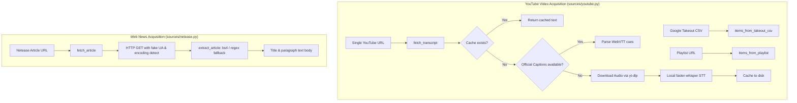

# OntoKB v2: Subsystem 02 — Content Ingestion & Sources

**Module Scope**: `src/ontokb/sources/youtube.py`, `src/ontokb/sources/netease.py`, `src/ontokb/sources/__init__.py`  
**Architectural Layer**: Layer 2 — Multimodal Ingestion Adapters  
**Dependencies**: `requests`, `urllib`, `re`, `csv`, `hashlib`, `tempfile`, optional `yt-dlp`, optional `faster-whisper` / `whisper`, optional `beautifulsoup4`.

---

## 1. Architectural Overview

OntoKB v2 decouples content acquisition from cognitive knowledge extraction. The Ingestion layer is responsible for taking arbitrary media URLs, playlists, or takeout dumps and normalizing them into plain-text `ContentItem` instances ready for LLM processing.



---

## 2. Module: `src/ontokb/sources/youtube.py`

### 2.1 File Purpose
Provides comprehensive YouTube content ingestion:
1. Video ID parsing from diverse URL formats and Google Takeout CSV watch histories.
2. Flat metadata extraction for YouTube playlists without downloading media.
3. Subtitle-first transcript acquisition via `yt-dlp`.
4. Automated fallback to local OpenAI Whisper / `faster-whisper` audio transcription when subtitles are missing or disabled.
5. Disk-backed caching in `data/transcripts/youtube/<vid>.txt`.

### 2.2 Functions Reference

#### 1. `_vid(url: str) -> str`
* **Signature**: `_vid(url: str) -> str`
* **Purpose**: Extracts the canonical 11-character YouTube video ID.
* **Mechanism**: Executes regular expression `(?:v=|youtu\.be/)([\w-]{11})`. If no standard pattern matches, computes `sha1(url.encode()).hexdigest()[:11]` as a deterministic fallback.
* **Returns**: 11-character string identifier.

#### 2. `items_from_takeout_csv(path: str | Path) -> list[ContentItem]`
* **Signature**: `items_from_takeout_csv(path: str | Path) -> list[ContentItem]`
* **Purpose**: Parses Google Takeout watch history exports.
* **Mechanism**:
  - Opens CSV using `encoding="utf-8-sig"` (handling Windows BOM).
  - Handles two distinct formats:
    - Formal Takeout export tables with headers.
    - Plain single-column text files of URLs.
  - Scans every cell for 11-character alphanumeric strings or YouTube domains.
  - Deduplicates video IDs using a `seen: set[str]`.
* **Returns**: List of `ContentItem` instances with `kind="video"` and `source="youtube"`.

#### 3. `items_from_playlist(playlist_url: str, cookies_file: str | None = None) -> list[ContentItem]`
* **Signature**: `items_from_playlist(playlist_url: str, cookies_file: str | None = None) -> list[ContentItem]`
* **Purpose**: Reads video metadata from a public or authenticated YouTube playlist without downloading media.
* **Mechanism**:
  - Invokes `yt_dlp.YoutubeDL` with `{"extract_flat": True, "quiet": True, "skip_download": True}`.
  - Passes `cookies_file` if provided for private or age-restricted playlists.
  - Extracts title, duration, and constructs canonical `https://www.youtube.com/watch?v={vid}` URLs.
* **Returns**: List of initialized `ContentItem` instances.

#### 4. `fetch_transcript(...) -> str`
* **Signature**:
  ```python
  fetch_transcript(
      item: ContentItem,
      cookies_file: str | None = None,
      langs: tuple[str, ...] = ("zh-Hans", "zh", "en"),
      whisper_model: str = "small",
      whisper_language: str | None = DEFAULT_WHISPER_LANGUAGE,
      whisper_device: str = "cpu",
      whisper_compute_type: str = "int8",
      cache_dir: str | Path | None = None,
      progress=None,
  ) -> str
  ```
* **Purpose**: Orchestrates two-tier transcript acquisition.
* **Step-by-Step Workflow**:
  1. **Cache Inspection**: Calls `_read_cached_transcript()`. If found, triggers progress callback and returns cached transcript immediately.
  2. **Subtitle Extraction (Tier 1)**: Invokes `yt_dlp.YoutubeDL` with `writesubtitles=True`, `writeautomaticsub=True`, `subtitlesformat="vtt"`, and requested language priority (`zh-Hans` $\to$ `zh` $\to$ `en`).
  3. If subtitles are downloaded: Calls `vtt_to_text()` to strip timing cues and formatting headers, checks `valid_transcript()`, caches to disk via `_write_cached_transcript()`, and returns text.
  4. **Audio Transcription Fallback (Tier 2)**: If no captions exist:
     - Downloads audio stream using `_download_audio_with_ytdlp()` to a temporary directory.
     - Invokes `_transcribe_audio_with_whisper()` using local `faster-whisper` (or standard `whisper`).
     - Cleans up temporary audio files.
     - Saves generated transcript to cache and returns text.
* **Returns**: Clean, raw transcript string.

#### 5. `vtt_to_text(vtt: str) -> str`
* **Signature**: `vtt_to_text(vtt: str) -> str`
* **Purpose**: Converts raw WebVTT subtitle data into continuous readable text paragraphs.
* **Mechanism**:
  - Strips `WEBVTT` file headers and metadata blocks (`NOTE`, `STYLE`).
  - Removes timestamp lines (`00:00:01.000 --> 00:00:04.000`).
  - Strips HTML inline tags (e.g. `<c>`, `<v Voice>`).
  - Deduplicates consecutive repeated subtitle lines caused by rolling captions.
* **Returns**: Normalized transcript paragraph.

#### 6. `valid_transcript(text: str) -> bool`
* **Signature**: `valid_transcript(text: str) -> bool`
* **Purpose**: Guard verifying that a retrieved transcript contains genuine semantic content.
* **Mechanism**: Checks whether stripped string length is at least 20 characters and contains printable words.
* **Returns**: `bool`.

#### 7. Cache & Helper Functions
* `_cache_path(cache_dir: str | Path | None, vid: str) -> Path`: Resolves `<cache_dir>/<vid>.txt` (default `data/transcripts/youtube/<vid>.txt`).
* `_read_cached_transcript(item: ContentItem, cache_dir: str | Path | None) -> str`: Reads disk cache if file exists; otherwise returns empty string.
* `_write_cached_transcript(item: ContentItem, cache_dir: str | Path | None, text: str) -> None`: Atomically writes transcript text to cache directory, creating parent folders if needed.
* `_normalize_whisper_language(lang: str) -> str`: Normalizes language codes (e.g. `zh-CN` $\to$ `zh`, `en-US` $\to$ `en`).

---

## 3. Module: `src/ontokb/sources/netease.py`

### 3.1 File Purpose
Fetches and extracts full article text bodies from Chinese news articles on NetEase (`163.com`), handling legacy character encodings and HTML boilerplate removal.

### 3.2 Functions Reference

#### 1. `item_from_url(url: str) -> ContentItem`
* **Signature**: `item_from_url(url: str) -> ContentItem`
* **Purpose**: Creates an unparsed `ContentItem` from a 163.com article URL.
* **Mechanism**: Generates an ID with prefix `163:` followed by the first 12 characters of the SHA-1 hash of the URL (`id="163:" + sha1(url)[:12]`). Sets `kind="article"` and `source="netease"`.
* **Returns**: `ContentItem` instance.

#### 2. `fetch_article(item: ContentItem, timeout: int = 20) -> str`
* **Signature**: `fetch_article(item: ContentItem, timeout: int = 20) -> str`
* **Purpose**: Performs HTTP request and populates `item.title` and `item.raw_text`.
* **Mechanism**:
  - Sends HTTP GET request with standard desktop browser `User-Agent` and `Accept-Language: zh-CN,zh;q=0.9`.
  - Fixes legacy encoding: if response encoding is `None` or `ISO-8859-1`, sets `resp.encoding = resp.apparent_encoding` to correctly decode GBK/GB2312/UTF-8.
  - Invokes `extract_article(html)`.
  - Assigns extracted title to `item.title`.
  - Raises `RuntimeError` if article body is empty.
* **Returns**: Extracted body text string.

#### 3. `extract_article(html: str) -> tuple[str, str]`
* **Signature**: `extract_article(html: str) -> tuple[str, str]`
* **Purpose**: Extracts clean headline and article paragraphs from raw HTML.
* **Mechanism**:
  1. **Title Extraction**: Regex search `<title>(.*?)</title>`, splitting off trailing site brand suffixes (e.g. `_网易科技`).
  2. **Primary Parser (BeautifulSoup)**:
     - Looks for container classes `class_="post_body"`, `id="content"`, or `<article>`.
     - Decomposes non-content elements (`<script>`, `<style>`, `<iframe>`).
     - Extracts text from all `<p>` tags and joins with newlines.
  3. **Fallback Parser (Regular Expressions)**:
     - If `bs4` is not installed or returns empty text, regex matches content within `class="post_body"[^>]*>(.*?)</div>`.
     - Extracts all `<p[^>]*>(.*?)</p>` matches, strips inner tags with `<[^>]+>`, and collapses whitespace.
* **Returns**: Tuple `(title: str, body_text: str)`.
