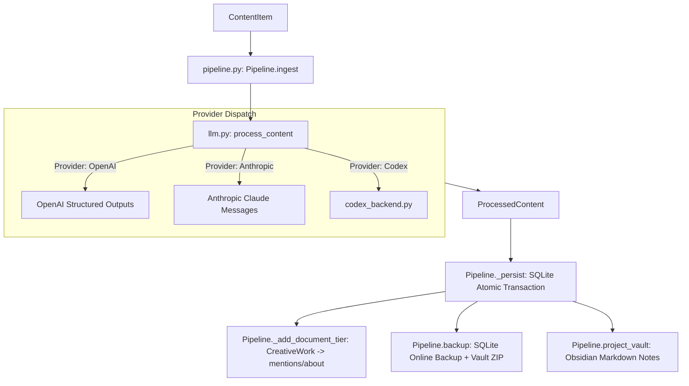

# OntoKB v2: Subsystem 03 — Pipeline, LLM & Extraction

**Module Scope**: `src/ontokb/pipeline.py`, `src/ontokb/llm.py`, `src/ontokb/codex_backend.py`  
**Architectural Layer**: Layer 3 — Ingestion Pipeline, Prompt Engineering & LLM Harness  
**Dependencies**: `openai`, `anthropic`, `pyyaml`, `sqlite3`, `zipfile`, `hashlib`, `subprocess`, `threading`, `queue`.

---

## 1. Architectural Overview

Subsystem 03 coordinates cognitive knowledge synthesis:
1. **End-to-End Pipeline (`pipeline.py`)**: Fetches content text, invokes LLMs for structured extraction, enforces two-tier graph topology (separating knowledge facts from document provenance), creates atomic backups, runs inference rules, and synchronizes Obsidian notes.
2. **Provider-Agnostic LLM Engine (`llm.py`)**: Formulates system prompts, compiles strict JSON schemas, and dispatches extraction and graph QA across OpenAI, Anthropic Claude (with server-side fallback), and the local Codex CLI.
3. **Local Codex App-Server Bridge (`codex_backend.py`)**: A JSON-RPC 2.0 subprocess manager that interacts with the `codex app-server` binary, implementing dynamic tool routing in a secure read-only sandbox.



---

## 2. Module: `src/ontokb/pipeline.py`

### 2.1 File Purpose
Orchestrates end-to-end knowledge ingestion. Implements atomic transaction rollbacks, creates zipped snapshots of database and vault states, and guarantees two-tier graph grounding so document nodes are never dependent on hallucinated LLM metadata.

### 2.2 Free Functions

#### 1. `analysis_stamp(text: str) -> dict`
* **Signature**: `analysis_stamp(text: str) -> dict`
* **Purpose**: Generates an epistemic fingerprint of source text to verify whether an existing analysis is strictly up to date.
* **Returns**:
  ```python
  {
      'source_sha256': hashlib.sha256(text.encode('utf-8')).hexdigest(),
      'source_characters': len(text),
      'analysis_version': 'source-grounded-v3'
  }
  ```

#### 2. `load_config(path: str | Path | None = None) -> dict`
* **Signature**: `load_config(path: str | Path | None = None) -> dict`
* **Purpose**: Reads YAML configuration.
* **Mechanism**: Checks candidate locations: specified `path` $\to$ `config/config.yaml` $\to$ `config/config.example.yaml`. Raises `FileNotFoundError` if missing.

### 2.3 Class `Pipeline`

#### Initialization
* `__init__(self, config: dict | None = None)`:
  - Binds configuration dictionary.
  - Instantiates `self.ontology` via `Ontology.load()`.
  - Instantiates `self.graph = GraphStore(..., ontology=self.ontology)`.
  - Instantiates `self.vault = ObsidianVault(...)`.
  - Instantiates `self.engine = RuleEngine.load(...)`.

#### Methods
* `fetch(self, item: ContentItem, progress=None) -> ContentItem`:
  - *Purpose*: Dispatches content acquisition to `sources/youtube.py` or `sources/netease.py`.
  - *Returns*: Updated `ContentItem` with populated `raw_text`.

* `ingest(self, item: ContentItem, client=None, *, replace_source=False) -> dict`:
  - *Purpose*: Main entry point for end-to-end ingestion.
  - *Algorithm*:
    1. Checks if `item.raw_text` exists; if not, calls `fetch(item)`.
    2. Calls `llm.process_content()` to extract structured entities, relations, summary, and interest scores.
    3. If `replace_source=True` (re-analysis), invokes `self.backup()` to create an instant rollback archive before modifying records.
    4. Executes `with self.vault.transaction(), self.graph.transaction():` to ensure dual-system atomicity.
    5. Calls `_persist(item, processed, now, replace_source)`.
  - *Returns*: Summary dictionary with keys `changed`, `entities_upserted`, `triples_added`, `rejections`, `backup`.

* `backup(self) -> str`:
  - *Purpose*: Creates a zero-downtime hot snapshot of the entire knowledge system.
  - *Mechanism*:
    1. Queries SQLite for database path (`PRAGMA database_list`).
    2. Generates a unique directory `data/backups/analysis-<uuid4>`.
    3. Invokes SQLite online backup API: `self.graph.conn.backup(dest)`.
    4. Zips all `.md` files in `self.vault.root` into `vault.zip`.
  - *Returns*: String path to the backup folder.

* `_persist(self, item, processed, now, replace_source) -> dict`:
  - *Purpose*: Internal transactional persistence routine.
  - *Mechanism*:
    1. If `replace_source=True`, cleans up existing triples associated with `item.id`.
    2. Upserts all extracted entities using `graph.upsert_entity()`.
    3. Calls `_add_document_tier()` to create document node and links.
    4. Inserts all extracted triples using `graph.add_triple()`.
    5. Records any schema rejections in metadata.
    6. Updates `contents` row with `analysis_stamp`, summary, and key points.
  - *Returns*: Metrics dictionary.

* `_add_document_tier(self, item, processed, now) -> None`:
  - *Purpose*: Enforces two-tier graph topology.
  - *Mechanism*:
    - Creates a `CreativeWork` subtype node (`VideoObject` for videos, `Article` for text).
    - Sets canonical metadata (`name=item.title`, `url=item.url`, `added_time=now`).
    - Connects the document node to every extracted entity via `mentions` or `about` edges.

* `run_rules(self) -> int`:
  - *Purpose*: Runs deductive inference engine over all graph triples, persisting inferred triples back to SQLite.

* `project_vault(self) -> None`:
  - *Purpose*: Re-writes Obsidian Markdown notes for all updated entities and sources.

---

## 3. Module: `src/ontokb/llm.py`

### 3.1 File Purpose
Houses prompt templates, strict JSON Schema generation routines, and multi-provider client dispatchers (OpenAI, Anthropic Claude, Codex).

### 3.2 Functions Reference

#### 1. `answer_graph_question(...) -> str`
* **Signature**:
  ```python
  answer_graph_question(
      question: str,
      graph_context: dict,
      *,
      client=None,
      provider: str | None = None,
      model: str | None = None,
      fallback_model: str | None = None,
  ) -> str
  ```
* **Purpose**: Generates natural language answers grounded strictly in retrieved graph facts.
* **Mechanism**:
  - Injects `GRAPH_QA_PROMPT` as system instructions.
  - Assembles prompt combining user question and JSON-encoded graph context.
  - Dispatches to OpenAI Chat Completions, Anthropic Messages API, or Codex CLI.
  - Catches refusal stop reasons and raises `RefusalError`.
* **Returns**: Generated answer string in the user's language.

#### 2. `process_content(...) -> ProcessedContent`
* **Signature**:
  ```python
  process_content(
      item: ContentItem,
      ontology: Ontology,
      interests: list[str],
      client=None,
      provider: str | None = None,
      model: str | None = None,
      fallback_model: str | None = None,
      output_language: str = DEFAULT_OUTPUT_LANGUAGE,
  ) -> ProcessedContent
  ```
* **Purpose**: Core knowledge extraction function.
* **Mechanism**:
  - Validates `item.raw_text` length ($\le 150,000$ characters).
  - Formats `SYSTEM_PROMPT_TEMPLATE` with user language and ontology schema summary.
  - Invokes provider-specific extractor (`_process_with_openai`, `_process_with_anthropic`, or Codex).
  - Parses LLM output into `ExtractionResult`, then converts to `ProcessedContent`.
* **Returns**: `ProcessedContent` instance.

#### 3. Provider Helpers
* `_process_with_openai(prompt, client, model, fallback_model, output_language) -> ExtractionResult`: Calls `client.beta.chat.completions.parse` with `response_format=ExtractionResult`.
* `_process_with_anthropic(prompt, client, model, fallback_model, output_language) -> ExtractionResult`: Invokes Claude with tool-use schema enforcing `ExtractionResult`.
* `_strict_schema(model_class: type[BaseModel]) -> dict`: Converts a Pydantic model into a strict JSON Schema adhering to OpenAI constraints (`additionalProperties: false`, required fields).

---

## 4. Module: `src/ontokb/codex_backend.py`

### 4.1 File Purpose
Provides a bridge to the local Codex app-server. Spawns `codex app-server` as a child process and communicates via JSON-RPC 2.0 over standard I/O in a sandboxed, read-only environment with dynamic tool delegation.

### 4.2 Functions Reference

#### 1. `executable() -> str | None`
* **Signature**: `executable() -> str | None`
* **Purpose**: Locates the `codex` executable on the system `PATH` or checks `ONTOKB_CODEX_BIN`.
* **Returns**: String path or `None`.

#### 2. `generate(...) -> str`
* **Signature**:
  ```python
  generate(
      instructions: str,
      prompt: str,
      *,
      model: str | None = None,
      schema: dict | None = None,
      timeout: float = 180,
      dynamic_tools=None,
      tool_handler=None,
  ) -> str
  ```
* **Purpose**: Executes an isolated reasoning turn via `codex app-server`.
* **Protocol Implementation**:
  1. Creates temporary working directory (`tempfile.TemporaryDirectory`).
  2. Spawns `subprocess.Popen([binary, "app-server"], stdin=PIPE, stdout=PIPE)`.
  3. Launches daemon reader thread queuing incoming JSON lines.
  4. Sends `initialize` request (`clientInfo: {name: 'ontokb', version: '0.2.0'}`).
  5. Sends `thread/start` request with `sandbox="read-only"`, `approvalPolicy="never"`, and registered `dynamicTools`.
  6. Sends `turn/start` with user input and optional JSON output schema.
  7. **Tool Call Dispatching**: If the model issues an `item/tool/call`, intercepts the message, validates that the tool is in `allowed_tools` and turn tool call count does not exceed limit (8), executes `tool_handler(tool, args)`, and returns the JSON result back to Codex.
  8. Awaits `turn/completed` event and returns agent response text.
  9. Safely terminates child process and cleans up resources.
* **Returns**: Output text response or structured string.
