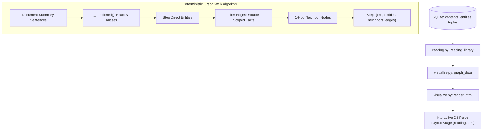

# OntoKB v2: Subsystem 04 — Reading, Visualization & Exploration

**Module Scope**: `src/ontokb/reading.py`, `src/ontokb/visualize.py`  
**Architectural Layer**: Layer 4 — Cognitive Reading, Graph Walk Extraction & Visual Layout  
**Dependencies**: Python standard library (`re`, `json`, `hashlib`, `urllib`), internal (`GraphStore`, `Pipeline`).

---

## 1. Architectural Overview

Subsystem 04 bridges the underlying relational knowledge graph with user-facing cognitive exploration:
1. **Source-Grounded Graph Walks (`reading.py`)**: Breaks down document summaries into discrete semantic sentences, extracts the exact entities mentioned in each step, and queries incident relationships restricted strictly to that document.
2. **Dynamic Categorization & Ingestion (`reading.py`)**: Allows users to paste raw article text directly into the web UI or categorize documents into browsing channels (`历史`, `科技`, `时政`, `经济`).
3. **Interactive Visualization Engine (`visualize.py`)**: Synthesizes the full graph dataset and reading library, inlines all CSS/JS bundles, and renders a zero-dependency standalone D3.js force-directed HTML graph.

---

## 2. Module: `src/ontokb/reading.py`

### 2.1 File Purpose
Houses the reading library synthesis engine. Implements strict, source-scoped graph walking that prevents the common hallucination where two entities appearing in the same summary sentence are falsely assumed to share a direct edge.

### 2.2 Functions Reference

#### 1. `_mentioned(text: str, name: str) -> bool`
* **Signature**: `_mentioned(text: str, name: str) -> bool`
* **Purpose**: Robust entity mention detector across mixed English and Chinese text.
* **Mechanism**:
  - Guards against empty names.
  - **ASCII / Latin Names**: Evaluates regular expression with regex boundary lookarounds:
    `(?<![A-Za-z0-9_])<escaped_name>(?![A-Za-z0-9_])`
    This ensures words like `Go` or `AI` do not trigger on substrings inside `Google` or `FAIL`.
  - **CJK Characters**: Uses case-folded substring containment: `name.casefold() in text.casefold()`.
* **Returns**: `bool`.

#### 2. `article_categories(title: str, meta: dict) -> list[str]`
* **Signature**: `article_categories(title: str, meta: dict) -> list[str]`
* **Purpose**: Classifies documents into browsing filter categories.
* **Algorithm**:
  1. Checks for manual human overrides: if `meta['categories']` is present and valid, returns it immediately.
  2. Assembles composite search string: `title + summary + topics`.
  3. Evaluates regex pattern dictionaries:
     - `实证类`: `实证|随机对照|实验研究|数据分析|案例研究|调查研究`
     - `AI类`: `(?<![a-zA-Z])AI(?![a-zA-Z])|人工智能|具身智能|机器人|大模型|机器学习|OpenAI`
     - `历史类`: `历史|政改|改革开放|文革|辛亥|近代|朝代`
     - `经济类`: `经济|金融|融资|投资|估值|泡沫|资本|通胀`
  4. Returns matched labels, or defaults to `['未分类']`.
* **Returns**: List of category strings.

#### 3. `set_article_category(graph, body: dict) -> dict`
* **Signature**: `set_article_category(graph, body: dict) -> dict`
* **Purpose**: Updates article classification in `contents.meta` without overwriting other properties.
* **Mechanism**:
  - Acquires non-blocking `_ingest_lock`. Raises `ValueError` if an ingestion task is currently active.
  - Validates `content_id` and category (`历史`, `科技`, `时政`).
  - Reads existing JSON metadata from SQLite, updates `meta['categories'] = [category]`, and writes back with `ensure_ascii=False`.
* **Returns**: `{'content_id': content_id, 'categories': [category]}`.

#### 4. `reading_library(graph) -> list[dict]`
* **Signature**: `reading_library(graph) -> list[dict]`
* **Purpose**: Compiles the comprehensive reading space dataset for all processed documents.
* **Step-by-Step Logic**:
  1. Loads all entities and normalized aliases into memory.
  2. Queries all triples joined with subject/object entity names.
  3. Iterates over all rows in `contents` where `status = 'processed'`.
  4. Filters entities and edges strictly belonging to the current document ID (`e['source'] == row['id']`).
  5. Identifies document self-nodes (`CreativeWork` / `Article`) and excludes them from candidate entity lists.
  6. Tokenizes the summary text into discrete sentence steps using sentence-ending punctuation `(?<=[。！？!?])\s*|\n+`.
  7. For each sentence step:
     - Finds all entities directly mentioned in that sentence (matching canonical name or aliases via `_mentioned()`).
     - Gathers eligible factual edges connected to those mentioned entities that originated from **this specific document**.
     - Sorts edges to prioritize relationships where **both** endpoints were directly mentioned in the sentence.
     - Collects 1-hop neighbor entity names.
     - Emits a step object: `{'text': sentence, 'entities': direct, 'neighbors': neighbors, 'edges': edges}`.
  8. Packages document record with title, URL, categories, key points, entity count, relation count, and steps.
* **Returns**: List of document library dictionaries.

#### 5. `ingest_article(store, body: dict, *, provider=None, model=None, fallback_model=None) -> dict`
* **Signature**: `ingest_article(store, body: dict, *, provider=None, model=None, fallback_model=None) -> dict`
* **Purpose**: Handles web UI article pasting.
* **Validation & Security**:
  - Validates title length (1–200 characters).
  - Validates body text length (20–100,000 characters).
  - Validates URL format (`http://` or `https://`).
  - Acquires `_ingest_lock` to prevent concurrency corruptions.
  - Checks if title collides with an existing non-document entity name.
  - Computes content ID: `article:<sha256(title + url + text)[:24]>`. If already processed, returns immediately with `{'content_id': cid, 'reused': True}`.
  - Launches `Pipeline.ingest()` and returns result.
* **Returns**: Processing metrics dictionary.

---

## 3. Module: `src/ontokb/visualize.py`

### 3.1 File Purpose
Exports or renders the knowledge base as a self-contained, responsive D3.js visualization web application.

### 3.2 Constants
* `_TYPE_COLORS`: High-contrast semantic palette mapping Schema.org types to dual hex color tuples `(base_fill, dark_accent)` (e.g. `Person` $\to$ `#1D9E75`, `Organization` $\to$ `#7F77DD`, `Claim` $\to$ `#EF9F27`, `DefinedTerm` $\to$ `#378ADD`).
* `_TYPE_LABELS_CN`: Chinese localization map for entity type badges.

### 3.3 Functions Reference

#### 1. `graph_data(graph: GraphStore) -> dict`
* **Signature**: `graph_data(graph: GraphStore) -> dict`
* **Purpose**: Assembles the complete JSON bundle needed by frontend visualization clients.
* **Mechanism**:
  - Queries `entities` table: extracts `name`, `entity_id`, `type`, `ontologyUri`, `reviewStatus`, `verificationStatus`.
  - Queries `triples` table: extracts distinct source `s`, predicate `p`, target `t`.
  - Calls `reading_library(graph)` to include document summaries and walking steps.
* **Returns**: Dictionary `{"nodes": [...], "edges": [...], "library": [...]}`.

#### 2. `render_html(data: dict, title: str = "Knowledge graph") -> str`
* **Signature**: `render_html(data: dict, title: str = "Knowledge graph") -> str`
* **Purpose**: Bundles HTML, CSS, JavaScript, and serialized database state into a single self-contained HTML file.
* **Security & Inlining Mechanism**:
  - Serializes graph data with `replace("<", "\\u003c")` to prevent script tag injection attacks when document titles contain HTML characters.
  - Loads `web/reading.html` template.
  - Reads and inlines stylesheets: `reading.css`, `editor.css`, `memory.css`.
  - Reads and inlines client scripts: `reading.js`, `assistant.js`, `editor.js`, `memory.js`.
  - Replaces placeholders: `__STYLE__`, `__SCRIPT__`, `__ASSISTANT__`, `__COLORS__`, `__FALLBACK__`, `__LABELS__`, `__TITLE__`, `__DATA__`.
* **Returns**: Complete HTML string.

#### 3. `export_html(graph: GraphStore, out_path: str | Path, title: str = "Knowledge graph") -> Path`
* **Signature**: `export_html(graph: GraphStore, out_path: str | Path, title: str = "Knowledge graph") -> Path`
* **Purpose**: Writes the rendered self-contained HTML page to a local file on disk.
* **Returns**: `Path` of the exported file.
