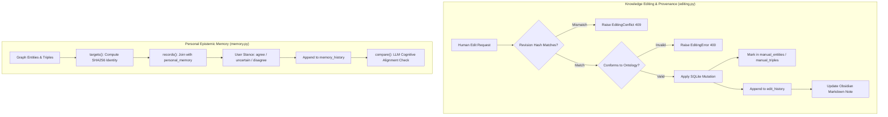

# OntoKB v2: Subsystem 05 — Knowledge Curation & Epistemic Memory

**Module Scope**: `src/ontokb/editing.py`, `src/ontokb/memory.py`  
**Architectural Layer**: Layer 5 — Human Knowledge Curation, Optimistic Concurrency & Epistemic Memory  
**Dependencies**: Python standard library (`sqlite3`, `hashlib`, `json`, `datetime`), internal (`GraphStore`, `Ontology`, `ObsidianVault`).

---

## 1. Architectural Overview

Subsystem 05 addresses a fundamental tension in automated knowledge management: **How to allow human operators to refine, correct, and disagree with machine extractions without their corrections being wiped out by future re-extractions, and without conflating objective factual statements with personal epistemic stances.**

OntoKB solves this through two complementary modules:
1. **Knowledge Editor (`editing.py`)**: Provides transactional human curation of entities and relationships, protected by optimistic concurrency revision tokens (`_revision(row)`), immune against LLM overwrite via `manual_entities` and `manual_triple_keys`, and backed by an atomic single-click undo journal.
2. **Epistemic Memory Engine (`memory.py`)**: Segregates subjective personal stances (`agree`, `uncertain`, `disagree`) from the objective knowledge graph. Retains an immutable audit log of viewpoint shifts across time (`memory_history`), and performs automated comparative synthesis to detect cognitive contradictions when reading new articles.

---

## 2. Module: `src/ontokb/editing.py`

### 2.1 File Purpose
Provides a transactional mutation service for human edits to the knowledge graph. Guarantees that human corrections are audited, can be undone with one click, and remain permanently protected against pipeline re-ingestions.

### 2.2 Exceptions & Decorators
* `EditingError(ValueError)`: Base exception for invalid editing operations.
* `EditingConflict(EditingError)`: Raised when the client's revision token does not match the current database row state (optimistic concurrency conflict).
* `_validation_errors(method)`: Decorator wrapping methods to intercept `OntologyError` and re-raise as user-friendly `EditingError`.

### 2.3 Free Functions

#### 1. `_json(value) -> str`
* Deterministic JSON serializer using `ensure_ascii=False` and `sort_keys=True`.

#### 2. `_revision(row) -> str`
* Computes `hashlib.sha256(_json(dict(row)).encode()).hexdigest()[:24]`. Generates an unambiguous state token representing the exact content of an entity or triple row.

#### 3. `source_triples(graph, source, knowledge_only=False) -> list[ExtractedTriple]`
* Queries all triples associated with a specific document source. If `knowledge_only=True`, filters out document-tier linking edges (`mentions`, `about`).

### 2.4 Class `EditingService`

#### Initialization
* `__init__(self, graph: GraphStore, vault: ObsidianVault | None = None)`: Binds database connection, ontology, and optional Obsidian vault writer.

#### Core State & Inspection Methods
* `_row(self, table: str, ident: int) -> dict`: Queries row by ID; raises `EditingError` if missing or deleted.
* `_entity(self, row: dict) -> dict`: Unpacks entity row, computes its `revision` hash, retrieves `verificationStatus`, and checks if flagged as `manual`.
* `bootstrap(self) -> dict`:
  - Returns complete dataset for the frontend editor modal:
    - `entities`: All entity records with revision tokens and manual flags.
    - `triples`: All relationship rows with subject/object names.
    - `history`: Last 50 entries from `edit_history` with localized difference descriptions (`changes`) and `can_undo` status.

#### Mutation Methods
* `rename_entity(self, entity_id: int, new_name: str, revision: str) -> dict`:
  - *Purpose*: Renames an entity and cascades the change across all incident relationships.
  - *Algorithm*:
    1. Validates revision hash against current row state.
    2. Normalizes `new_name` via `normalize()`.
    3. Asserts no other entity already owns this normalized name.
    4. Updates `entities.name` and `entities.norm_name`.
    5. Flags entity ID in `manual_entities` so future pipeline ingestions preserve this human choice.
    6. Appends audit entry into `edit_history` storing full before-and-after states.
    7. Updates Obsidian vault note file on disk.

* `mutate_alias(self, entity_id: int, alias: str, action: str, revision: str) -> dict`:
  - *Purpose*: Adds or removes an alternative name / alias.
  - *Mechanism*: Validates revision, verifies that the alias does not collide with another entity in `aliases`, updates JSON array in `entities.aliases`, updates `aliases` table, and logs audit record.

* `change_entity_type(self, entity_id: int, new_type: str, revision: str) -> dict`:
  - *Purpose*: Reclassifies an entity (e.g. from `DefinedTerm` to `SoftwareApplication`).
  - *Mechanism*: Validates revision, verifies that all existing incident edges still satisfy the domain/range constraints of `new_type` under `self.ontology`, updates `entities.type`, flags `manual_entities`, and updates Obsidian note frontmatter.

* `delete_entity(self, entity_id: int, revision: str) -> dict`:
  - *Purpose*: Deletes an entity and cleans up dangling references.
  - *Mechanism*: Validates revision, deletes all incident triples from `triples`, unlinks aliases, removes entity note from Obsidian vault via `vault.remove_entity_note()`, deletes row from `entities`, and logs before-state to `edit_history`.

* `create_triple(self, subject: str, predicate: str, object: str, evidence="", confidence=1.0) -> dict`:
  - *Purpose*: Manually asserts a relationship.
  - *Mechanism*: Resolves subject and object IDs, asserts ontology validity, inserts row into `triples`, flags row in `manual_triples`, registers key in `manual_triple_keys`, and records creation in `edit_history`.

* `update_triple(self, triple_id: int, predicate: str, evidence: str, revision: str) -> dict`:
  - *Purpose*: Modifies relation predicate or supporting quote.
  - *Mechanism*: Validates revision, asserts ontology domain/range compliance, updates `triples`, flags `manual_triples`, and logs to `edit_history`.

* `delete_triple(self, triple_id: int, revision: str) -> dict`:
  - *Purpose*: Removes a triple.
  - *Mechanism*: Validates revision, marks in `manual_triples` as `deleted=1`, deletes from `triples`, and logs before-state to `edit_history`.

* `undo(self) -> dict`:
  - *Purpose*: Reverts the most recent active curation action.
  - *Algorithm*:
    1. Finds highest `id` in `edit_history` where `undone = 0`.
    2. Decodes `before_state` JSON.
    3. Re-inserts or restores previous entity or triple attributes.
    4. Marks record as `undone = 1`.
  - *Returns*: Information about the reverted operation.

---

## 3. Module: `src/ontokb/memory.py`

### 3.1 File Purpose
Houses the Epistemic Memory engine. It separates user stances from extracted facts, guarantees that review approvals do not silently carry over to new extractions with different evidence, and detects cognitive tension between incoming articles and established personal viewpoints.

### 3.2 Database Schema
* `personal_memory`: Stores user curation reviews:
  - `key TEXT PRIMARY KEY`: Deterministic SHA-256 target identifier.
  - `snapshot TEXT NOT NULL`: JSON snapshot of target at review time.
  - `reviewed INTEGER NOT NULL DEFAULT 0`: Whether operator reviewed item.
  - `included INTEGER NOT NULL DEFAULT 0`: Whether included in personal worldview.
  - `stance TEXT NOT NULL DEFAULT 'unset'`: One of `unset`, `agree`, `uncertain`, `disagree`.
  - `note TEXT NOT NULL DEFAULT ''`: Personal reflection notes.
  - `revision INTEGER NOT NULL DEFAULT 0`: Monotonically increasing revision counter.
  - `updated_at TEXT NOT NULL`: ISO-8601 timestamp.
* `memory_history`: Append-only audit log:
  - `id INTEGER PRIMARY KEY AUTOINCREMENT`.
  - `memory_key TEXT NOT NULL`.
  - `before_state TEXT NOT NULL`.
  - `after_state TEXT NOT NULL`.
  - `source_id TEXT NOT NULL DEFAULT ''`.
  - `created_at TEXT NOT NULL`.

### 3.3 Class `MemoryService`

#### Target Identification & Identity Protection
* `targets(self) -> dict[str, dict]`:
  - *Purpose*: Computes deterministic SHA-256 identity keys for every entity, claim, and relationship.
  - *Evidence-Locked Identity*: For a triple, the identity hash incorporates:
    `['triple', subject_id, subject_name, predicate, object_id, object_name, source, evidence]`
  - *Design Rationale*: Source and quote are part of a reviewed assertion's identity. If an entity or relationship is extracted again in a future document with different evidence or context, it receives a **distinct key**, ensuring that an approval of evidence A is never silently inherited by unexamined evidence B.

* `records(self) -> list[dict]`:
  - Merges active targets with saved rows from `personal_memory`.

* `bootstrap(self) -> dict`:
  - Provides complete state for the frontend personal memory drawer: `{records: [...], history: [...], sources: [...]}`.

#### Curation Updates & Optimistic Concurrency
* `update(self, payload: dict) -> dict`:
  - *Purpose*: Records user stance updates.
  - *Mechanism*:
    - Verifies revision counter: `payload['revision'] == existing_row['revision']`. If mismatched, raises `EditingConflict`.
    - Increments revision integer.
    - Appends transition record to `memory_history`.
    - Updates `personal_memory`.
  - *Returns*: Updated record.

#### Comparative Synthesis
* `compare(self, source_id: str, provider=None, model=None, fallback_model=None) -> dict`:
  - *Purpose*: Evaluates how an incoming document aligns with or contradicts established personal memory stances.
  - *Workflow*:
    1. Gathers all entities and assertions associated with `source_id`.
    2. Queries user's reviewed memory records to find overlap with these entities.
    3. Constructs an epistemic comparison prompt contrasting the document's claims with the user's historical stances (`agree`, `disagree`, `uncertain`).
    4. Calls LLM (`llm.answer_graph_question()` or `codex_backend.generate()`).
    5. Returns synthesis report highlighting agreements, tensions, and new perspectives.
