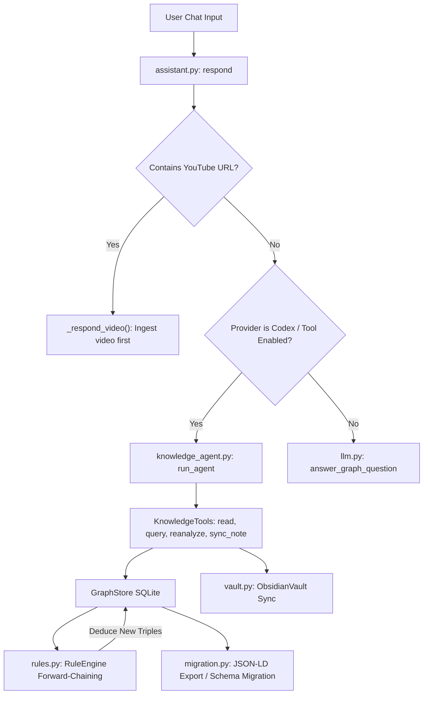

# OntoKB v2: Subsystem 06 — Assistant, Agent, Rules & Projections

**Module Scope**: `src/ontokb/assistant.py`, `src/ontokb/chat_history.py`, `src/ontokb/knowledge_agent.py`, `src/ontokb/rules.py`, `src/ontokb/vault.py`, `src/ontokb/migration.py`  
**Architectural Layer**: Layer 6 — Conversational Grounding, Deductive Logic & External Projections  
**Dependencies**: Python standard library (`sqlite3`, `re`, `json`, `pathlib`, `dataclasses`, `threading`), `pyyaml`, internal modules.

---

## 1. Architectural Overview

Subsystem 06 manages cognitive reasoning, deductive inference, conversational memory, and external file projections:
1. **Conversational Grounding (`assistant.py`, `chat_history.py`)**: Intercepts chat prompts, detects embedded video links to trigger automatic background ingestion, and constructs grounded graph retrieval prompts with sanitized multi-turn dialogue memory.
2. **Autonomous Tool-Use Agent (`knowledge_agent.py`)**: Executes an autonomous ReAct loop with registered, validated host tools (`kb_read_document`, `kb_query_graph`, `kb_reanalyze_document`, `kb_sync_note`).
3. **Forward-Chaining Rule Engine (`rules.py`)**: Executes deterministic, forward-chaining logical deduction over graph triples to fixpoint without calling LLMs.
4. **Obsidian Vault Projection (`vault.py`)**: Continuously projects the SQLite knowledge graph into an Obsidian-compatible Markdown vault with YAML frontmatter, backlinks, and atomic transaction rollbacks.
5. **Schema Migration & JSON-LD Export (`migration.py`)**: Upgrades existing graphs to Schema.org standards and exports semantic web W3C JSON-LD graphs.

---

## 2. Module: `src/ontokb/assistant.py`

### 2.1 File Purpose
Coordinates conversational interactions, video ingestion triggering, and question-answering context assembly.

### 2.2 Global State & Locks
* `_ingest_lock = threading.Lock()`: Process-wide mutual exclusion lock preventing concurrent ingestion jobs from colliding or locking the SQLite database.

### 2.3 Functions Reference

#### 1. `video_url(text: str) -> Optional[tuple[str, str]]`
* **Signature**: `video_url(text: str) -> Optional[tuple[str, str]]`
* **Purpose**: Scans user chat messages for embedded YouTube links.
* **Mechanism**: Executes regular expression matching standard YouTube URLs (`youtube.com/watch?v=...` or `youtu.be/...`). Returns `(canonical_url, video_id)` or `None`.

#### 2. `respond(store: GraphStore, question: str, progress=None, **options) -> dict`
* **Signature**: `respond(store: GraphStore, question: str, progress=None, **options) -> dict`
* **Purpose**: Main entry point for chat interactions.
* **Workflow**:
  1. Validates and bounds conversational context via `chat_history.validate_history()`.
  2. Inspects question for video URLs via `video_url()`. If detected, routes execution to `_respond_video()`.
  3. If provider is Codex or tool mode is enabled, routes to `knowledge_agent.run_agent()`.
  4. Otherwise:
     - Extracts candidate entity names mentioned in the question.
     - Gathers 1-hop graph neighborhood from `store.related_graph()`.
     - Formats factual relations context.
     - Calls `llm.answer_graph_question()`.
* **Returns**: Dictionary `{"answer": str, "entities": list, "context": dict}`.

#### 3. `_respond_video(...) -> dict`
* **Purpose**: Background video ingestion and answer synthesis.
* **Mechanism**: Acquires `_ingest_lock`, initializes `Pipeline`, downloads video transcript/audio, extracts entities and triples, saves document tier, and generates a welcoming answer summarizing the newly ingested video.

---

## 3. Module: `src/ontokb/chat_history.py`

### 3.1 File Purpose
Sanitizes, bounds, and structures multi-turn conversational history to prevent context window overflow and prompt injection.

### 3.2 Constants & Functions

#### 1. Constants
* `MAX_HISTORY_MESSAGES = 10`: Retains at most the last 10 messages (5 dialogue turns).
* `MAX_MESSAGE_CHARS = 2000`: Caps individual message text length at 2,000 characters.

#### 2. `validate_history(raw_history: list) -> list[dict]`
* **Signature**: `validate_history(raw_history: list) -> list[dict]`
* **Purpose**: Enforces strict structural schema on conversation history arrays.
* **Mechanism**:
  - Drops malformed items (non-dictionaries or missing fields).
  - Validates `role` (`user` or `assistant`).
  - Truncates `content` string to `MAX_MESSAGE_CHARS`.
  - Slices array to retain only the most recent `MAX_HISTORY_MESSAGES`.
* **Returns**: Cleaned list of `{"role": str, "content": str}` dictionaries.

---

## 4. Module: `src/ontokb/knowledge_agent.py`

### 4.1 File Purpose
Implements an autonomous ReAct agent running against validated, host-controlled knowledge tools. While the LLM environment remains read-only, registered host tools perform safe, validated mutations on the knowledge base.

### 4.2 Tool Registry

The agent is equipped with five registered tools:
1. `kb_list_documents`: Enumerate all saved documents and their identifiers.
2. `kb_read_document`: Inspects document metadata, raw transcript, current summary, and Obsidian note text.
3. `kb_query_graph`: Performs graph searches across entities and relational triples.
4. `kb_reanalyze_document`: Re-runs LLM extraction on full source text, creating an instant rollback backup and synchronizing notes.
5. `kb_sync_note`: Rewrites the Obsidian markdown note from saved analysis without re-extracting.

### 4.3 Class `KnowledgeTools`

* `__init__(self, store, selected, options, progress)`: Binds database, selected document ID, LLM options, and progress callback.
* `pipe(self) -> Pipeline`: Instantiates an internal `Pipeline` instance.
* `resolve(self, target: str) -> sqlite3.Row`: Resolves document targets (by URL, video ID, or selected dropdown state).
* `read(self, target: str) -> dict`: Reads note contents and checks `analysis_stamp(text)` to verify if the note is fresh.
* `query(self, query: str) -> dict`: Executes `store.related_graph(query)`.
* `reanalyze(self, target: str) -> dict`: Re-ingests document with backup.
* `sync_note(self, target: str) -> dict`: Regenerates note file in `vault/Sources/`.

### 4.4 Function `run_agent(...) -> dict`
* Executes the multi-step agent reasoning loop, dispatching tool calls to `KnowledgeTools` methods until a final synthesized answer is produced.

---

## 5. Module: `src/ontokb/rules.py`

### 5.1 File Purpose
Evaluates declarative, forward-chaining deduction rules over relational triples. Operates 100% deterministically without LLM calls.

### 5.2 Supported Pattern Operators
The rule matcher supports rich comparative operators:
* `gte` ($\ge$), `lte` ($\le$), `gt` ($>$), `lt` ($<$), `eq` ($=$), `ne` ($\ne$), `in` ($\in$), `contains` (substring/membership).

### 5.3 Classes & Methods

#### 1. `match_pattern(fact: dict, pattern: dict) -> bool`
* Asserts whether a factual triple dictionary conforms to a rule condition pattern.

#### 2. `Rule` & `Action` (dataclasses)
* Encapsulate rule definitions (`when.all` antecedent patterns, `then` consequent actions).

#### 3. `RuleEngine` (dataclass)
* `load(cls, path: str | Path) -> RuleEngine`: Parses `rules/default.yaml`.
* `run(self, facts: list[dict]) -> list[Action]`: Evaluates working set to fixpoint or until `max_iterations = 10` is reached.
* `apply(self, graph: GraphStore) -> int`: Collects facts from `graph.facts()`, executes `self.run()`, translates `add_triple` actions into `graph.add_triple()` calls, and returns total newly deduced triples count.

---

## 6. Module: `src/ontokb/vault.py`

### 6.1 File Purpose
Synchronizes the SQLite knowledge graph with a local Obsidian markdown vault, generating structured notes with YAML frontmatter, backlinks, and bidirectional `[[Wikilinks]]`.

### 6.2 Directory Structure
The vault organizes notes into five top-level folders:
* `Sources/`: Source document notes (videos, articles) with summaries, key points, and extracted facts.
* `Entities/`: Entity concept notes with properties, aliases, and incoming/outgoing relationship links.
* `Wiki/`: Synthesized topic overviews.
* `MOC/`: Maps of Content generated by rule engine.
* `Reports/`: Periodic review summaries.

### 6.3 Free Functions & Class `ObsidianVault`

#### 1. `slugify(name: str) -> str`
* Strips illegal filename characters (`\ / : * ? " < > | # ^ [ ]`) to ensure safe file paths on Windows, macOS, and Linux.

#### 2. `ObsidianVault` Methods
* `__init__(self, root: str | Path)`: Binds vault directory and ensures top-level folders exist.
* `_write(self, rel: str, text: str) -> Path`: Atomic file writer. Writes text to `.tmp` file and performs atomic replace (`temporary.replace(path)`).
* `transaction(self)`: Context manager implementing a memory-backed rollback journal. Records original file bytes before mutation; if an unhandled exception occurs, completely restores all altered and deleted files.
* `write_content_note(self, item: ContentItem, processed: ProcessedContent) -> Path`: Emits markdown document note with complete frontmatter, summaries, and wikilinks.
* `write_entity_note(self, graph: GraphStore, name: str) -> Path | None`: Reads entity row and incident edges from SQLite, compiles markdown note with type badges and linked neighbors, and saves to `Entities/<name>.md`.
* `remove_entity_note(self, name: str) -> None`: Deletes entity note file on entity deletion.
* `rebuild(self, graph: GraphStore) -> int`: Regenerates all entity notes across the vault.

---

## 7. Module: `src/ontokb/migration.py`

### 7.1 File Purpose
Provides zero-data-loss schema migrations and standards-compliant W3C JSON-LD graph exports.

### 7.2 Functions Reference

#### 1. `migration_plan(graph: GraphStore, ontology: Ontology, overrides=None) -> dict`
* Performs a dry-run migration check. Identifies legacy class mappings (`Content` $\to$ `Article`/`VideoObject`, `Technology` $\to$ `DefinedTerm`), checks alias ambiguities, validates relation domain/ranges, and flags entities requiring human review (`needs_review`).

#### 2. `migrate_graph(graph: GraphStore, ontology: Ontology, backup_dir: Path, overrides=None, *, apply=False) -> dict`
* Applies schema migration within an atomic `BEGIN IMMEDIATE` transaction, creating an instant database backup before updating records.

#### 3. `export_jsonld(graph: GraphStore, out_path: str | Path) -> Path`
* Exports the entire knowledge graph as a W3C Schema.org JSON-LD document with `@context: "https://schema.org"` and `@graph` array.
