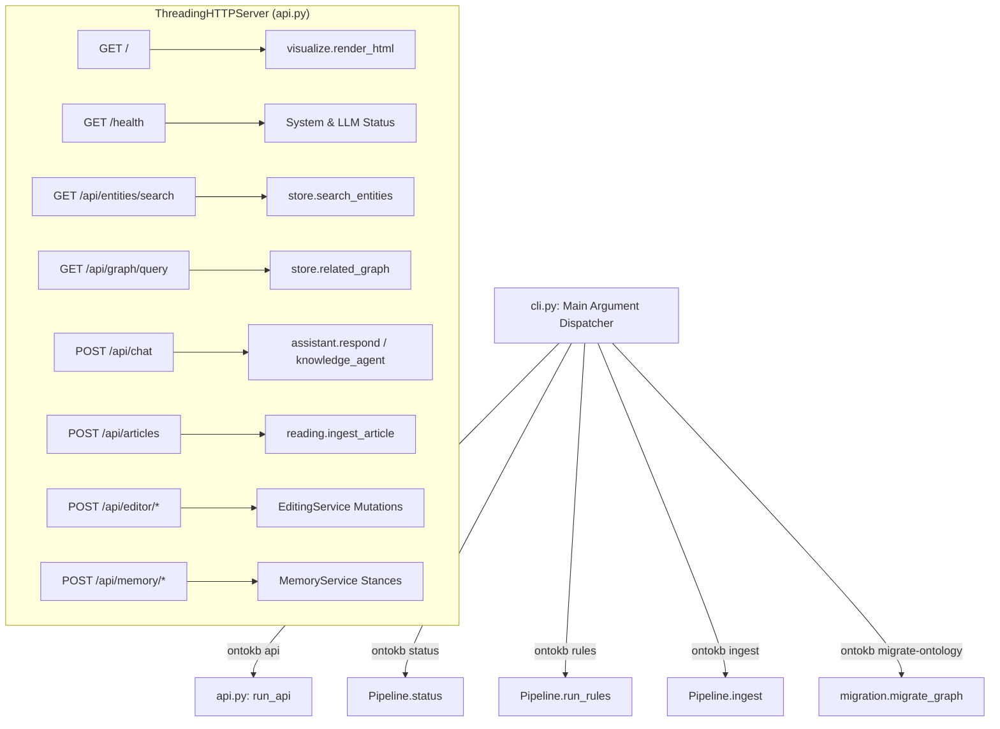

# OntoKB v2: Subsystem 07 — API Server & CLI

**Module Scope**: `src/ontokb/api.py`, `src/ontokb/cli.py`  
**Architectural Layer**: Layer 7 — Network Server & Command-Line Interfaces  
**Dependencies**: Python standard library (`http.server`, `urllib`, `argparse`, `json`, `socket`, `struct`, `shutil`), internal modules.

---

## 1. Architectural Overview

Subsystem 07 exposes the knowledge base to local users and client applications:
1. **HTTP/1.1 REST Server (`api.py`)**: A multi-threaded HTTP server utilizing `ThreadingHTTPServer`. It serves the interactive web client, validates local origin access, streams JSON payloads with socket protection, and routes search, editing, memory, and chat requests.
2. **Command-Line Interface (`cli.py`)**: A unified CLI tool supporting knowledge base management, pipeline execution, rule engine evaluation, Schema.org migration, and server hosting.



---

## 2. Module: `src/ontokb/api.py`

### 2.1 File Purpose
Provides a lightweight, zero-external-dependency REST API server. Handles CORS, prevents cross-origin unauthorized mutations, and implements Windows-specific network socket protections (`SO_LINGER`) to ensure complete transmission of large visual bundles.

### 2.2 Network Architecture & Socket Stability
* `protocol_version = "HTTP/1.1"`: Enforces persistent HTTP/1.1 connections with explicit `Content-Length` headers.
* **Windows Socket Protection**: In `setup()`, configures `SOL_SOCKET, SO_LINGER` with a 5-second lingering window:
  ```python
  self.connection.setsockopt(socket.SOL_SOCKET, socket.SO_LINGER, struct.pack("ii", 1, 5))
  ```
  *Problem Solved*: On Windows systems, Python's default socket implementation sends TCP RST packets prematurely when closing connections with remaining unacknowledged packets, causing clients to experience `WinError 10054` or socket truncated downloads at ~120 KB. `SO_LINGER` forces the operating system to buffer and wait for client TCP ACKs.
* **Output Stream Flushing**: Calls `self.wfile.flush()` immediately after writing payloads to force immediate TCP buffer transmission.

### 2.3 Free Functions

#### 1. `run_api(...) -> None`
* **Signature**:
  ```python
  run_api(
      db_path: str | Path,
      host: str = "127.0.0.1",
      port: int = 8765,
      *,
      provider: str | None = None,
      model: str | None = None,
      fallback_model: str | None = None,
  ) -> None
  ```
* **Purpose**: Instantiates `ThreadingHTTPServer((host, port), Handler)` and enters `serve_forever()` loop.

#### 2. Query Parsers & Formatting Helpers
* `_one(params, name, default) -> str`: Safely extracts single query parameter string.
* `_required(params, name) -> str`: Extracts parameter or raises `ValueError`.
* `_limit(params, default=50, max_limit=200) -> int`: Extracts and clamps integer bounds.
* `_bool(params, name, default=False) -> bool`: Parses boolean flags (`true`, `1`, `yes`).
* `_relations_table(relations: list[dict]) -> str`: Formats relationships as GitHub markdown tables.
* `_entities_mentioned_in_question(store, question: str) -> list[str]`: Greedily matches entity names and aliases occurring in natural language questions.

### 2.4 Class `GraphApiHandler`

#### Request Routing
* `do_GET(self) -> None`:
  - `/`: Inlines graph data and renders standalone interactive HTML via `visualize.render_html()`.
  - `/health`: Emits diagnostic JSON reporting status, UI version, and whether LLM keys are configured.
  - `/api/entities/search`: Calls `store.search_entities(q, mode, limit, expand)`.
  - `/api/graph/query`: Calls `store.related_graph(q, limit, expand)`.
  - `/api/reading`: Returns reading space library JSON.
  - `/api/editor`: Returns `EditingService.bootstrap()` JSON.
  - `/api/memory`: Returns `MemoryService.bootstrap()` JSON.

* `do_POST(self) -> None`:
  - **CSRF / Origin Check**: Verifies that `Origin` header matches `localhost`, `127.0.0.1`, or `::1` matching server port. Rejects foreign origins with `HTTPStatus.FORBIDDEN (403)`.
  - **Content-Type Check**: Rejects payloads without `application/json`.
  - `/api/chat`: Validates question, conversation history, and invokes conversational engine.
  - `/api/articles`: Ingests raw article text via `reading.ingest_article()`.
  - `/api/reading/category`: Updates category via `reading.set_article_category()`.
  - `/api/editor/entity/rename`: Calls `EditingService.rename_entity()`.
  - `/api/editor/entity/alias`: Calls `EditingService.mutate_alias()`.
  - `/api/editor/entity/type`: Calls `EditingService.change_entity_type()`.
  - `/api/editor/entity/delete`: Calls `EditingService.delete_entity()`.
  - `/api/editor/triple/create`: Calls `EditingService.create_triple()`.
  - `/api/editor/triple/update`: Calls `EditingService.update_triple()`.
  - `/api/editor/triple/delete`: Calls `EditingService.delete_triple()`.
  - `/api/editor/undo`: Calls `EditingService.undo()`.
  - `/api/memory/review`: Calls `MemoryService.update()`.
  - `/api/memory/compare`: Calls `MemoryService.compare()`.

---

## 3. Module: `src/ontokb/cli.py`

### 3.1 File Purpose
Unified command-line interface entry point. Supports automation, batch processing, and offline administration.

### 3.2 Subcommands Reference

1. `ontokb status`:
   - Prints counts of entities, triples, processed documents, and queue sizes.
2. `ontokb rules`:
   - Evaluates deductive rule engine over all graph triples, printing every rule action fired.
3. `ontokb queue`:
   - Loads Google Takeout CSV watch histories or configured URLs into the pending queue.
4. `ontokb backfill`:
   - Reconstructs document-tier nodes (`CreativeWork`) for legacy v1 graphs.
5. `ontokb ingest <url>`:
   - Fetches and processes a single YouTube video or article URL end-to-end.
6. `ontokb visualize [-o path]`:
   - Regenerates the standalone interactive D3 HTML graph file.
7. `ontokb migrate-ontology [--apply] [--report path] [--overrides path]`:
   - Generates a dry-run migration plan or transactionally applies Schema.org schema upgrades.
8. `ontokb export-jsonld [--out path]`:
   - Exports the SQLite graph into a W3C Schema.org compliant JSON-LD graph file.
9. `ontokb api [--host 127.0.0.1] [--port 8765]`:
   - Launches the HTTP REST API server.
