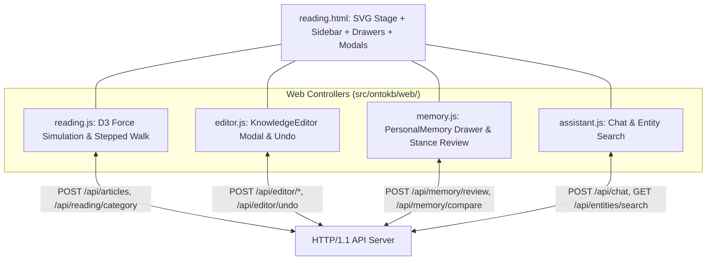

# OntoKB v2: Subsystem 08 — Web Frontend Controllers

**Module Scope**: `src/ontokb/web/reading.js`, `src/ontokb/web/editor.js`, `src/ontokb/web/memory.js`, `src/ontokb/web/assistant.js`  
**Architectural Layer**: Layer 8 — Interactive Visual Frontend, D3 Simulation & State Controllers  
**Dependencies**: D3.js v7 (CDN), Native Browser DOM APIs, CSS Grid & Flexbox.

---

## 1. Architectural Overview

The OntoKB web interface is a high-performance, single-page cognitive workspace designed to run locally with zero build steps, bundlers, or heavy frontend frameworks.

The frontend is partitioned into four decoupled controllers:
1. **Interactive Graph & Guided Reading (`reading.js`)**: Runs the D3 force simulation, handles SVG canvas zoom/pan transforms, smoothly animates the camera to frame focused entities, and coordinates stepped summary walks with auto-tour timers.
2. **Knowledge Editor Modal (`editor.js`)**: Manages transactional human editing of entities, aliases, types, and relational edges with optimistic concurrency revision tokens and single-click undo.
3. **Personal Epistemic Memory Drawer (`memory.js`)**: Manages the review drawer, stance toggle controls (`agree`, `uncertain`, `disagree`), immutable viewpoint shift histories, and LLM cognitive alignment comparisons.
4. **Chat & Search Drawer (`assistant.js`)**: Coordinates multi-turn grounded conversations, detects pasted YouTube links, searches graph entities, and renders chat bubbles with entity pill links.

---

## 2. Controller: `src/ontokb/web/reading.js`

### 2.1 Role & Architecture
Primary UI controller orchestrating the D3.js force-directed canvas and the stepped document reader.

### 2.2 Global State & Physics Setup
* `nodes`: Array of entity node objects (`{id, entity_id, type, ontologyUri, reviewStatus, verificationStatus, degree}`).
* `links`: Array of relationship objects (`{source, target, p}`).
* `sim`: `d3.forceSimulation(nodes)` configured with:
  - `forceLink(links).id(n => n.id).distance(110).strength(0.18)`
  - `forceManyBody().strength(-240)`
  - `forceCenter(W/2, H/2)`
  - `forceCollide(34)`
* Pre-warmed physics: runs 180 layout simulation ticks synchronously (`for(let i=0;i<180;i++) sim.tick()`) on startup before initial paint to eliminate visually jarring node explosions.

### 2.3 Key Functions Reference

#### 1. `renderGraph()`
* Mounts the SVG element, initializes D3 zoom behavior (`scaleExtent([0.25, 3])`), binds double-click reset handlers, and renders links, edge hitboxes, edge labels, and node circles.
* Configures node radii dynamically via `size(n) = Math.min(7 + Math.sqrt(n.degree) * 1.8, 17)`.
* Generates legend chips and type filter options dynamically based on present Schema.org types.

#### 2. `focusCamera(ids: Set<string>, animated: bool = true)`
* **Purpose**: Smoothly frames target entities inside the SVG viewport.
* **Mechanism**:
  1. Computes bounding box enclosing all target node coordinates: `(cx, cy)`.
  2. Calculates optimal zoom scale clamped between `0.25` and `1.45`.
  3. Computes target zoom transform: `d3.zoomIdentity.translate(W/2 - scale*cx, H/2 - scale*cy).scale(scale)`.
  4. Animates camera smoothly over 1,200ms using `d3.easeCubicInOut`, respecting user `prefers-reduced-motion` settings.

#### 3. `paint(ids: Set<string>, keys: Set<string>)`
* **Purpose**: Dual-layer visual focus rendering.
* **Mechanism**: Sets opacity of focused nodes to `1.0` (with active ring glow) while dimming unfocused background nodes to `0.09`. Sets focused edges to `0.9` opacity while dimming unfocused edges to `0.035`.

#### 4. `selectStep(index: int, automatic: bool = false)`
* **Purpose**: Activates a specific sentence step during document reading.
* **Mechanism**:
  - Updates step indicator (`Step X of Y`).
  - Gathers step's directly mentioned entities, 1-hop neighbor nodes, and incident fact edges.
  - Invokes `paint()` to focus only those entities and edges.
  - Invokes `focusCamera()` to frame the step's semantic cluster.
  - Renders takeaways and relationship list inside the reader sidebar panel.

#### 5. `schedule()` & `stopTour()`
* Controls automated step-walking playback. Iterates through document steps based on user-selected speed (6s, 10s, 15s) and loops back upon completion.

#### 6. Context Menu & Accessibility
* `beginGraphMenu()`, `positionGraphMenu()`, `closeGraphMenu()`: Manages custom floating context menus for nodes and edges.
* Supports full keyboard accessibility: `ArrowDown`, `ArrowUp`, `Escape`, `Tab`, `Home`, `End`, and standard context key (`Shift+F10`).

---

## 3. Controller: `src/ontokb/web/editor.js`

### 3.1 Role & Architecture
Manages the Knowledge Editor modal. Enables human operators to audit machine-extracted knowledge, rename entities, mutate aliases, reclassify entity types, assert new relations, and undo mistakes.

### 3.2 Key Methods & Handlers

#### 1. Namespace `window.KnowledgeEditor`
* `openEntity(name: str)`: Opens modal with entity pre-selected, populating name, type, alias list, and revision token.
* `openRelation(relation: object)`: Opens modal pre-focused on a relationship edge.

#### 2. Mutation Handlers
* Form submit handlers intercept user submissions and dispatch POST requests with revision tokens:
  - `/api/editor/entity/rename`
  - `/api/editor/entity/alias`
  - `/api/editor/entity/type`
  - `/api/editor/entity/delete`
  - `/api/editor/triple/create`
  - `/api/editor/triple/update`
  - `/api/editor/triple/delete`
* **Concurrency Guard**: If server responds with HTTP 409 (revision mismatch), displays conflict notification prompting user to refresh.
* **Undo Handler**: Submits POST to `/api/editor/undo`, restores previous state, and updates the graph canvas.

---

## 4. Controller: `src/ontokb/web/memory.js`

### 4.1 Role & Architecture
Controls the Personal Memory slide-out drawer, allowing users to record subjective stances and evaluate cognitive alignment with incoming content.

### 4.2 Key Methods & Handlers

#### 1. Stance Management
* Renders target cards for entities, claims, and triples with evidence quotes.
* Provides interactive stance toggle buttons: `赞同 (agree)`, `存疑 (uncertain)`, `不赞同 (disagree)`.
* Dispatches updates to `/api/memory/review` including `key`, `stance`, `note`, `included`, and `revision`.

#### 2. Audit Trail & History View
* Displays chronological transitions from `memory_history`, showing when and why stances were modified over time.

#### 3. Comparative Synthesis (`handleCompare`)
* Submits POST to `/api/memory/compare` passing `source_id`.
* Displays synthesized markdown evaluation showing how the selected document supports, contradicts, or extends the user's historical viewpoints.

---

## 5. Controller: `src/ontokb/web/assistant.js`

### 5.1 Role & Architecture
Controls the Conversational Assistant and Graph Search drawer.

### 5.2 Key Methods & Handlers

#### 1. Tab Switching
* Toggles between **Entity Search** view and **AI Assistant Chat** view.

#### 2. Graph Search
* Submits queries to `/api/entities/search?q=...`.
* Renders matching entity rows with type badges and clickable neighbor chips that focus the main graph canvas on click.

#### 3. Conversational Chat
* Manages local `chatHistory` array.
* Detects YouTube URLs in user prompts: renders visual badge indicating background video ingestion.
* Dispatches POST to `/api/chat` with `{question, history, selected_document}`.
* Renders conversational bubbles with Markdown rendering, entity pill links, and error banners.
