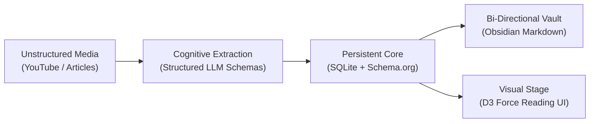
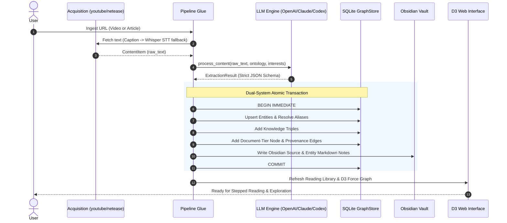

# OntoKB v2: The 10-Minute Architectural Primer

**Target Audience**: Developers, architects, and technical contributors  
**Estimated Reading Time**: 8–10 minutes  
**Document Purpose**: A high-level, conceptual abstraction of the OntoKB v2 architecture. This document skips low-level syntactic boilerplate to focus exclusively on the core mental models, architectural invariants, and design philosophies required to master the codebase.

---

## 1. The Core Thesis: Why OntoKB Exists

Standard AI research tools rely on **naive RAG (Retrieval-Augmented Generation)**: they chop documents into vector embeddings and perform cosine similarity search. While fast, RAG suffers from fatal structural flaws for long-term personal knowledge:
* **No Entity Identity**: The LLM does not know that "OpenAI", "GPT Maker", and "Sam Altman's company" refer to the same real-world entity.
* **Semantic Drift & Amnesia**: Past facts cannot be systematically updated, contradicted, or queried relationally.
* **Subjective Conflation**: An unverified claim made by a speaker in a video is ingested as a factual truth.

**OntoKB replaces RAG with a Local-First, Schema-Governed Knowledge Graph.**  
It continuously ingests multimodal content (YouTube videos, web articles), extracts typed entities and relational triples compliant with a Schema.org ontology profile, stores them in an ACID SQLite database, projects them into an Obsidian markdown vault, and presents them in an interactive cognitive reading environment.

---

## 2. The 5 Invariant Mental Models

To understand the codebase, you only need to grasp five foundational mental models.

### Model 1: The Two-Tier Graph Invariant
The most critical architectural pattern in OntoKB is the separation between **Knowledge Facts** and **Document Provenance**:

1. **The Knowledge Tier (Extracted by LLMs)**:  
   Entities connected to other entities:  
   $$\text{Person} \xrightarrow{\text{worksFor}} \text{Organization} \quad\text{or}\quad \text{Claim} \xrightarrow{\text{supports}} \text{Claim}$$
2. **The Document Tier (Deterministically Added by the Host)**:  
   Every ingested video or article is assigned a canonical document node (`VideoObject` or `Article`). The pipeline *automatically* connects this document node to every extracted entity via `mentions` and `about` edges.

> [!IMPORTANT]
> **The Golden Invariant**: Document grounding is **never** delegated to LLM hallucination. The host pipeline deterministically injects document provenance. If a document is re-analyzed or deleted, its provenance edges can be pruned cleanly without destroying the canonical real-world entities.

---

### Model 2: Closed-World Schema.org Governance
OntoKB rejects the open-ended ontology explosion common in naive LLM graph builders (where models invent classes like `"TechGuru"` or `"CoolSoftware"`).

* **Strict Profile**: Only **8 Schema.org classes** are permitted:  
  `Thing` $\to$ `CreativeWork` (`Article`, `VideoObject`), `Person`, `Organization`, `DefinedTerm`, `Claim`.
* **Single-Parent Inheritance**: Every class has exactly one parent, forming a strictly acyclic tree rooted at `Thing`.
* **Domain & Range Verification**: Every triple is checked against allowed subject/object classes:
  $$\text{worksFor}: \text{Person} \implies \text{Organization}$$
* **No Type Widening**: If an entity is already established as a `Person`, a lazy LLM extracting it later as a generic `Thing` will **never demote** the specific type.

---

### Model 3: Entity Resolution & Human Immunity
Entities are resolved canonically across documents using normalized names and aliases:
$$\text{normalize}(text) = \text{re.sub}\left(\texttt{\\s+}, \texttt{" "}, \text{unicodedata.normalize}(\texttt{"NFKC"}, text).\text{casefold}().\text{strip}()\right)$$

In addition, Chinese Simplified and Traditional character variants (e.g. `达` $\leftrightarrow$ `達`, `国` $\leftrightarrow$ `國`) are dynamically expanded during search.

> [!TIP]
> **Human Curation Immunity**: When a human curator modifies an entity name, alias, or relationship in the Web Editor, that record is stamped into `manual_entities` and `manual_triple_keys`. From that moment on, future automated pipeline runs are **forbidden** from overwriting the human decision.

---

### Model 4: Epistemic Segregation (Facts vs Claims vs Stances)
Knowledge is not monolithic; OntoKB enforces a three-way distinction:

| Concept | What It Represents | Where It Lives | Epistemic Status |
| :--- | :--- | :--- | :--- |
| **Fact** | An objective relationship (e.g. Google acquired DeepMind) | `triples` table | Objective truth verified by source text |
| **Claim** | An assertion or prediction made by a speaker (e.g. "AGI by 2027") | `entities` (type `Claim`) | Subjective assertion; speaker linked via `makesClaim` |
| **Stance** | The *user's* personal worldview (agree, disagree, uncertain) | `personal_memory` table | Private human judgment; segregated from graph |

* **Evidence-Locked Identity**: When a user reviews and agrees with a relationship, that approval incorporates the SHA-256 hash of the specific `(source, quote)` evidence. If a new article mentions the same relationship with different evidence, it receives a fresh identity and will not silently inherit past approval.

---

### Model 5: Stepped Cognitive Reading (The Visual Stage)
OntoKB is not just a graph viewer; it is a **reading accelerator**:
1. When an article is loaded, its summary is tokenized into sentence-by-sentence "steps".
2. For each sentence step, the engine determines which entities are explicitly mentioned.
3. When the user navigates to a step, the D3 camera smoothly flies to and frames those entities.
4. **Focused Dimming**: Active step nodes remain at `1.0` opacity with active halos, while unrelated background nodes dim to `0.09` opacity.
5. **Zero Hallucination Walking**: The reader only traverses edges that **originated from this exact document**.

---

## 3. The End-to-End System Dataflow

Here is what happens when you feed a URL into OntoKB:

---

## 4. Persistence & Concurrency Guarantees

OntoKB achieves production-grade local stability through three technical safeguards:

1. **Dual-System ACID Atomicity**:  
   SQLite operations execute under `BEGIN IMMEDIATE` transactions. Concurrently, the `ObsidianVault` maintains an in-memory byte journal. If an operation fails mid-way, SQLite rolls back automatically and the vault restores original Markdown files from the byte journal.
2. **Optimistic Concurrency Control (OCC)**:  
   When human users edit an entity or triple via the UI, the client sends a `revision` hash:
   $$\text{revision} = \text{sha256}(\text{json\_serialize}(\text{row}))[:24]$$
   If another process altered the record in the background, the server rejects the edit with HTTP 409 Conflict, preventing silent data loss.
3. **Windows Socket Protection (`SO_LINGER`)**:  
   On Windows operating systems, large HTTP JSON transmissions (>120 KB) frequently suffer from premature TCP RST drops (`WinError 10054`). OntoKB's server configures `SOL_SOCKET, SO_LINGER` (5-second lingering window) and enforces immediate output stream flushes (`wfile.flush()`), guaranteeing complete visual payloads reach the browser.

---

## 5. Codebase Rosetta Stone: Where Everything Lives

| Subsystem | Key Files | What Happens Here |
| :--- | :--- | :--- |
| **Core Storage & Schema** | `models.py` `ontology.py` `graph.py` | Pydantic type definitions, Schema.org closed-world acyclicity validation, SQLite schema, CJK variant search, and entity merging. |
| **Multimodal Ingestion** | `sources/youtube.py` `sources/netease.py` | YouTube URL parsing, subtitle extraction, local Whisper audio transcription fallback, and NetEase HTML scraping. |
| **Extraction Engine** | `pipeline.py` `llm.py` `codex_backend.py` | End-to-end orchestration, two-tier graph insertion, multi-provider LLM calling, strict schema formatting, and local Codex CLI harness. |
| **Reading & Visual Stage** | `reading.py` `visualize.py` `web/reading.js` | Source-scoped summary walking algorithm, category derivation, D3 force simulation, and camera zoom animations. |
| **Human Curation & Stance**| `editing.py` `memory.py` `web/editor.js` `web/memory.js` | Optimistic locking, single-click undo journal, subjective stance reviews, and LLM cognitive contradiction comparison. |
| **Cognitive Agent & Rules** | `assistant.py` `knowledge_agent.py` `rules.py` `vault.py` | ReAct autonomous agent with validated host tools, forward-chaining rule engine to fixpoint, and atomic Obsidian file sync. |
| **Networking & CLI** | `api.py` `cli.py` | HTTP/1.1 REST server with `SO_LINGER` protection, local origin security checks, and CLI subcommand dispatching. |

---

## 6. Quick-Reference Architectural Glossary

* **ACID**: Atomicity, Consistency, Isolation, Durability. Guaranteed via SQLite WAL mode and vault file transaction journals.
* **Closed-World Ontology**: An approach where only explicitly declared classes and predicates are legal; unknown entities are rejected or marked `needs_review`.
* **Two-Tier Graph**: The intentional separation of semantic knowledge edges ($A \to B$) from document provenance edges ($\text{Doc} \to A$).
* **Epistemic Stance**: A human judgment (`agree`, `disagree`, `uncertain`) attached to a specific claim or relationship, segregated from the objective graph.
* **Fixpoint**: The state reached by the forward-chaining rule engine where no new deductive triples can be inferred from existing facts.
* **Human Immunity**: Protection mechanism ensuring machine re-extraction never overrides an operator's manual edits.
