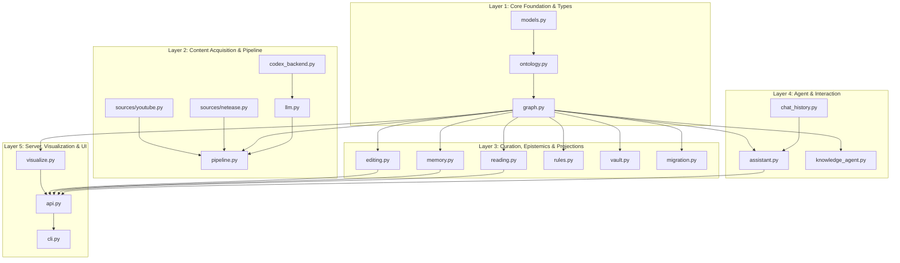

# OntoKB v2: Complete Codebase Function & Class Catalog

**Document Suite**: OntoKB Technical Reference Manual  
**Version**: 2.0.0  
**Target Path**: `codebase_documentation/`  
**Scope**: Every file, class, method, and function across the entire OntoKB v2 repository.

---

## Table of Contents

1. [Architectural Layering & Dependency Graph](#1-architectural-layering--dependency-graph)
2. [Subsystem 1: Core Data Models & Schema Governance](#2-subsystem-1-core-data-models--schema-governance)
   - [2.1 `src/ontokb/models.py`](#21-srcontokbmodelspy)
   - [2.2 `src/ontokb/ontology.py`](#22-srcontokbontologypy)
   - [2.3 `src/ontokb/graph.py`](#23-srcontokbgraphpy)
3. [Subsystem 2: Multimodal Content Acquisition](#3-subsystem-2-multimodal-content-acquisition)
   - [3.1 `src/ontokb/sources/youtube.py`](#31-srcontokbsourcesyoutubepy)
   - [3.2 `src/ontokb/sources/netease.py`](#32-srcontokbsourcesneteasepy)
4. [Subsystem 3: LLM Extraction & Processing Pipeline](#4-subsystem-3-llm-extraction--processing-pipeline)
   - [4.1 `src/ontokb/pipeline.py`](#41-srcontokbpipelinepy)
   - [4.2 `src/ontokb/llm.py`](#42-srcontokbllmpy)
   - [4.3 `src/ontokb/codex_backend.py`](#43-srcontokbcodex_backendpy)
5. [Subsystem 4: Reading, Visualization & Guided Walking](#5-subsystem-4-reading-visualization--guided-walking)
   - [5.1 `src/ontokb/reading.py`](#51-srcontokbreadingpy)
   - [5.2 `src/ontokb/visualize.py`](#52-srcontokbvisualizepy)
6. [Subsystem 5: Knowledge Editing & Epistemic Memory](#6-subsystem-5-knowledge-editing--epistemic-memory)
   - [6.1 `src/ontokb/editing.py`](#61-srcontokbeditingpy)
   - [6.2 `src/ontokb/memory.py`](#62-srcontokbmemorypy)
7. [Subsystem 6: Conversational Agent, Rules & Projections](#7-subsystem-6-conversational-agent-rules--projections)
   - [7.1 `src/ontokb/assistant.py`](#71-srcontokbassistantpy)
   - [7.2 `src/ontokb/chat_history.py`](#72-srcontokbchat_historypy)
   - [7.3 `src/ontokb/knowledge_agent.py`](#73-srcontokbknowledge_agentpy)
   - [7.4 `src/ontokb/rules.py`](#74-srcontokbrulespy)
   - [7.5 `src/ontokb/vault.py`](#75-srcontokbvaultpy)
   - [7.6 `src/ontokb/migration.py`](#76-srcontokbmigrationpy)
8. [Subsystem 7: Server & Command-Line Interfaces](#8-subsystem-7-server--command-line-interfaces)
   - [8.1 `src/ontokb/api.py`](#81-srcontokbapipy)
   - [8.2 `src/ontokb/cli.py`](#82-srcontokbclipy)
9. [Subsystem 8: Web Frontend Controllers (`src/ontokb/web/`)](#9-subsystem-8-web-frontend-controllers-srcontokbweb)
   - [9.1 `src/ontokb/web/reading.js`](#91-srcontokbwebreadingjs)
   - [9.2 `src/ontokb/web/editor.js`](#92-srcontokbwebeditorjs)
   - [9.3 `src/ontokb/web/memory.js`](#93-srcontokbwebmemoryjs)
   - [9.4 `src/ontokb/web/assistant.js`](#94-srcontokbwebassistantjs)

---

## 1. Architectural Layering & Dependency Graph

---

## 2. Subsystem 1: Core Data Models & Schema Governance

### 2.1 `src/ontokb/models.py`
* **File Purpose**: Defines strictly typed Pydantic models used across storage, API serializations, and LLM structured output decoding.
* **Classes**:
  1. `ContentItem(BaseModel)`: Represents an ingested media item.
     - `id: str`: Deterministic identifier (`yt:<vid>` or `article:<hash>`).
     - `kind: Literal["video", "article"]`: Source modality.
     - `source: Literal["youtube", "netease", "other"]`: Origin platform.
     - `url: str`: Web address.
     - `title: str = ""`: Document headline.
     - `published_at: Optional[str]`: Publication date string.
     - `duration_seconds: Optional[int]`: Duration for video items.
     - `raw_text: str = ""`: Full transcript or extracted article body.
  2. `Property(BaseModel)`:
     - `key: str`, `value: str`: Simple tuple representation ensuring strict OpenAI JSON schema compatibility.
  3. `ExtractedEntity(BaseModel)`:
     - `name: str`: Primary entity identifier.
     - `type: str`: Schema.org class name (`Person`, `Organization`, etc.).
     - `aliases: list[str]`: Synonyms and abbreviations.
     - `properties: dict[str, str]`: Dynamic dictionary of attributes.
  4. `ExtractedTriple(BaseModel)`:
     - `subject: str`, `predicate: str`, `object: str`: Fact statement.
     - `confidence: float = 0.8`: Quality confidence score ($0.0 \dots 1.0$).
     - `evidence: str = ""`: Verbatim quote from source document.
  5. `ProcessedContent(BaseModel)`:
     - Output container produced after LLM parsing. Holds `content_id`, `summary`, `key_points`, `topics`, `relevance` scores, `entities`, and `triples`.
  6. `RelevanceScore(BaseModel)`:
     - `interest: str`, `score: float`: Topic scoring container.
  7. `LLMEntity(BaseModel)`:
     - LLM-facing entity structure using `list[Property]` instead of an open map.
     - `to_extracted(self) -> ExtractedEntity`: Unpacks `Property` pairs into a standard Python dictionary.
  8. `ExtractionResult(BaseModel)`:
     - The target schema handed to LLMs for structured completions.
     - `to_processed(self, content_id: str) -> ProcessedContent`: Converts raw LLM output into internal `ProcessedContent`.

---

### 2.2 `src/ontokb/ontology.py`
* **File Purpose**: Loads `ontology/core.yaml`, verifies class hierarchy acyclicity, enforces domain/range restrictions, and provides prompt summaries.
* **Exceptions**:
  - `OntologyError(ValueError)`: Raised whenever an invalid class, predicate, or domain/range violation occurs.
* **Classes & Methods**:
  1. `RelationDef` (dataclass):
     - `name: str`: Relation predicate name.
     - `domain: str | list[str]`: Permitted subject classes.
     - `range: str | list[str]`: Permitted object classes.
     - `symmetric: bool = False`: Whether relation applies in reverse ($A \to B \implies B \to A$).
     - `uri: str = ""`, `description: str = ""`: Schema documentation.
  2. `Ontology` (dataclass):
     - `load(cls, path: str | Path) -> Ontology`: Class method that reads a YAML specification, validates that parent classes exist, instantiates `RelationDef` objects, and verifies the inheritance graph contains no cycles.
     - `canonical_class(self, name: str) -> str`: Resolves legacy aliases (e.g. `Technology` $\to$ `DefinedTerm`, `Content` $\to$ `CreativeWork`).
     - `canonical_relation(self, name: str) -> str`: Resolves legacy relation aliases (e.g. `worksAt` $\to$ `worksFor`).
     - `has_class(self, name: str) -> bool`: Checks if an entity type exists in the ontology.
     - `is_subclass(self, cls_name: str, ancestor: str) -> bool`: Traverses parent pointers to check inheritance equality or subtyping.
     - `validate_entity(self, entity_type: str) -> None`: Asserts entity class validity; raises `OntologyError` on unknown classes.
     - `validate_triple(self, subject_type: str, predicate: str, object_type: str) -> None`: Validates predicate existence and checks that subject and object types satisfy allowed domain and range classes.
     - `prompt_summary(self) -> str`: Compiles a compact markdown guide of all classes and relations for LLM prompt injection.

---

### 2.3 `src/ontokb/graph.py`
* **File Purpose**: Manages SQLite storage (`data/kb.db`), entity resolution, alias merging, provenance protection, and graph querying.
* **Free Functions**:
  - `normalize(name: str) -> str`: Performs NFKC normalization, lowercase conversion, and whitespace collapse.
  - `_query_terms(query: str, mode: str) -> list[str]`: Tokenizes query into terms or preserves phrase.
  - `_expanded_query_terms(query: str, base_terms: list[str]) -> list[str]`: Augments query terms with subphrases.
  - `_variant_query_terms(terms: list[str]) -> list[str]`: Expands terms with Chinese Traditional/Simplified character variants.
  - `_term_variants(term: str, limit: int = 64) -> list[str]`: Recursive permutation generator across Chinese character variant mappings.
  - `_dedupe_terms(terms: list[str]) -> list[str]`
  - `_entity_dict(row: sqlite3.Row) -> dict`: Unpacks an SQLite entity row and parses JSON properties.
  - `_add_entity_match(matches: dict, row: sqlite3.Row, term: str) -> None`: Accumulates matched entity hits in search.
  - `_edge_dict(row: sqlite3.Row) -> dict`: Formats a triple record with source and confidence fields.
* **`GraphStore` Class Methods**:
  - `__init__(self, path=":memory:", ontology=None)`: Connects SQLite, runs `_SCHEMA` and `MEMORY_SCHEMA`, runs migrations.
  - `_migrate(self) -> None`: Adds missing `sources`, `added_time`, and `created_at` columns to legacy databases.
  - `close(self) -> None`: Closes SQLite database connection.
  - `_commit(self)`: Commits transaction if not inside an active `transaction()` block.
  - `transaction(self)`: Context manager running `BEGIN IMMEDIATE` and managing rollbacks.
  - `upsert_entity(self, entity: ExtractedEntity, source="", added_time="") -> int`: Resolves entity by name/alias. If already present in `manual_entities`, preserves human overrides; otherwise updates aliases, properties, and accumulates document source IDs.
  - `_resolve(self, norm: str) -> Optional[sqlite3.Row]`: Queries `entities` by normalized name, falling back to `aliases` index.
  - `get_entity(self, name: str) -> Optional[sqlite3.Row]`: Looks up an entity by name.
  - `degree(self, entity_id: int) -> int`: Returns total count of triples attached to this entity.
  - `search_entities(self, query: str, mode="terms", limit=50, expand=False) -> list[dict]`: Searches entities across normalized names and aliases using SQL `LIKE`.
  - `related_graph(self, query: str, mode="terms", limit=20, expand=False) -> dict`: Performs 1-hop traversal around matched query entities, returning nodes, edges, and documents.
  - `add_triple(self, triple: ExtractedTriple, ontology: Ontology, source="", entity_types=None, created_at="") -> bool`: Validates endpoints and ontology rules; checks `manual_triple_keys` immunity; inserts into `triples`. Returns `False` on duplicate.
  - `neighbors(self, entity_id: int) -> list[sqlite3.Row]`: Retrieves all incident 1-hop edges for a given entity ID.
  - `_entities_by_id(self, ids: set[int]) -> list[dict]`: Fetches entities by set of IDs.
  - `_contents_by_id(self, ids: set[str]) -> list[dict]`: Fetches document records by set of content string IDs.
  - `contents_by_id(self, ids) -> list[dict]`: Public wrapper for `_contents_by_id`.
  - `upsert_content(self, content_id: str, kind: str, source: str, url: str, title="", status="queued", meta=None) -> None`: Writes document metadata into `contents`.
  - `facts(self) -> Iterator[dict]`: Yields all factual triples across the database.

---

## 3. Subsystem 2: Multimodal Content Acquisition

### 3.1 `src/ontokb/sources/youtube.py`
* **File Purpose**: Ingests YouTube videos by retrieving official/auto-generated transcripts, or downloading audio and executing local Whisper transcription.
* **Functions**:
  - `_vid(url: str) -> str`: Extracts the 11-character video ID from any YouTube URL format.
  - `items_from_takeout_csv(path: str | Path) -> list[ContentItem]`: Parses Google Takeout watch history exports into ingestion items.
  - `items_from_playlist(playlist_url: str) -> list[ContentItem]`: Uses `yt-dlp` to enumerate all video URLs in a public playlist.
  - `fetch_transcript(item: ContentItem, progress=None) -> ContentItem`: Orchestrator: attempts caption download first, then falls back to audio download + Whisper speech-to-text.
  - `valid_transcript(text: str) -> bool`: Checks if transcript length meets minimum threshold ($\ge 20$ chars).
  - `_fetch_caption_text(vid: str, proxies=None) -> str`: Calls `youtube-transcript-api` to pull Chinese/English subtitles.
  - `_cache_path(transcript_dir: Path, vid: str) -> Path`: Calculates cache file location (`data/transcripts/youtube/<vid>.txt`).
  - `_read_cached_transcript(item: ContentItem, transcript_dir: Path) -> str`: Reads existing transcript from disk.
  - `_write_cached_transcript(transcript_dir: Path, vid: str, text: str) -> None`: Saves transcript to disk cache.
  - `_download_audio(url: str, out_dir: Path, progress=None) -> Path`: Executes `yt-dlp` to extract an audio file from YouTube.
  - `_transcribe_with_whisper(audio_path: Path, language="zh", model_name="base") -> str`: Invokes local OpenAI Whisper model for audio transcription.
  - `_normalize_whisper_language(lang: str) -> str`: Maps language codes to ISO 639-1 standards.
  - `vtt_to_text(vtt_content: str) -> str`: Strips WebVTT timestamps and formatting cues.

---

### 3.2 `src/ontokb/sources/netease.py`
* **File Purpose**: Scrapes Chinese news articles from Netease (163.com).
* **Functions**:
  - `item_from_url(url: str) -> ContentItem`: Initializes a `ContentItem` with source `"netease"`.
  - `fetch_article(item: ContentItem) -> ContentItem`: Downloads the web page, runs `extract_article()`, and stores text in `item.raw_text`.
  - `extract_article(html: str) -> tuple[str, str]`: Parses HTML to extract article title and main paragraph text.

---

## 4. Subsystem 3: LLM Extraction & Processing Pipeline

### 4.1 `src/ontokb/pipeline.py`
* **File Purpose**: Coordinates end-to-end ingestion: content acquisition, LLM extraction, two-tier graph creation, backups, and vault syncing.
* **Free Functions**:
  - `analysis_stamp(text: str) -> dict`: Produces a SHA-256 fingerprint and character count over text.
  - `load_config(path=None) -> dict`: Loads and parses `config/config.yaml`.
  - `report_stub(...)`: Migration reporting helper.
* **`Pipeline` Class Methods**:
  - `__init__(self, config=None)`: Binds ontology, `GraphStore`, `ObsidianVault`, and `RuleEngine`.
  - `fetch(self, item: ContentItem, progress=None) -> ContentItem`: Dispatches to `sources/youtube.py` or `sources/netease.py` based on `item.source`.
  - `ingest(self, item: ContentItem, client=None, replace_source=False) -> dict`: Core processing pipeline. Fetches text, invokes `process_content()`, executes atomic transaction, creates two-tier graph, runs backups, applies rules, and regenerates vault notes.
  - `backup(self) -> str`: Copies `data/kb.db` and zips `vault/` into a timestamped directory under `data/backups/`.
  - `_persist(self, item, processed, now, replace_source) -> dict`: Inserts entities, triples, rejections, and content metadata into database.
  - `_add_document_tier(self, item, processed, now) -> None`: Automatically inserts the document node (`CreativeWork`) and connects it to all extracted entities via `mentions` and `about` edges.
  - `run_rules(self) -> int`: Evaluates the deductive rule engine on the updated graph.
  - `project_vault(self) -> None`: Rebuilds Obsidian vault Markdown notes for all updated entities.

---

### 4.2 `src/ontokb/llm.py`
* **File Purpose**: Manages system prompts, context truncation, structured output generation, and multi-provider LLM calling.
* **Classes & Functions**:
  - `RefusalError(Exception)`: Raised when model refuses generation.
  - `answer_graph_question(question, context, provider=None, model=None, fallback_model=None) -> str`: Formulates answers based on retrieved graph context.
  - `process_content(item, ontology, interests, client=None, provider=None, model=None, fallback_model=None, output_language="Simplified Chinese") -> ProcessedContent`: Main extraction method. Assembles extraction instructions, calls model, and parses response into `ProcessedContent`.
  - `_process_with_openai(prompt, client, model, fallback_model, output_language) -> ExtractionResult`: Invokes OpenAI Chat Completions API with structured outputs.
  - `_process_with_anthropic(prompt, client, model, fallback_model, output_language) -> ExtractionResult`: Invokes Anthropic Claude API with tool-use schema.
  - `_response_text(choice) -> str`: Normalizes response text across provider SDKs.
  - `_strict_schema(model_class: type[BaseModel]) -> dict`: Generates OpenAI strict JSON schema definitions.

---

### 4.3 `src/ontokb/codex_backend.py`
* **File Purpose**: Interfaces with local OpenAI Codex CLI.
* **Functions**:
  - `executable() -> Optional[str]`: Finds the `codex` command on PATH.
  - `generate(prompt: str, model: str = None) -> str`: Spawns a child process passing `prompt` to `codex exec` via standard input.

---

## 5. Subsystem 4: Reading, Visualization & Guided Walking

### 5.1 `src/ontokb/reading.py`
* **File Purpose**: Ingests articles, manages categories, and generates the guided summary walking dataset.
* **Functions**:
  - `_mentioned(text: str, name: str) -> bool`: Regex matcher that checks if an entity name or alias appears in `text`, handling word boundaries for Latin characters and substring containment for CJK characters.
  - `article_categories(title: str, meta: dict) -> list[str]`: Derives article categories (`科技`, `历史`, `时政`, `经济`) based on keywords in title, summary, or manual tags.
  - `set_article_category(graph, body: dict) -> dict`: Updates the `categories` property in `contents.meta` without overwriting other document metadata.
  - `reading_library(graph) -> list[dict]`
  - `ingest_article(store, body: dict, provider=None, model=None, fallback_model=None) -> dict`: Validates title (1–200 chars) and body (20–100,000 chars), acquires `_ingest_lock`, initializes `Pipeline`, and triggers extraction.

---

### 5.2 `src/ontokb/visualize.py`
* **File Purpose**: Generates standalone interactive D3 force layout web pages.
* **Functions**:
  - `graph_data(graph: GraphStore) -> dict`: Queries all entities, types, review statuses, and triples from SQLite and pairs them with `reading_library()`.
  - `render_html(data: dict, title: str = "OntoKB · 日常知识库") -> str`: Inlines CSS stylesheets, JS scripts, and serializes `DATA = __DATA__` into the `reading.html` template.
  - `export_html(graph: GraphStore, out_path: str | Path, title="Knowledge graph") -> Path`: Exports the standalone HTML page to a local file.

---

## 6. Subsystem 5: Knowledge Editing & Epistemic Memory

### 6.1 `src/ontokb/editing.py`
* **File Purpose**: Manages human knowledge curation, alias management, type reclassifications, relation editing, and single-click undo history.
* **Exceptions & Free Functions**:
  - `EditingError(ValueError)` / `EditingConflict(EditingError)`: Conflict exception raised on revision mismatch.
  - `_validation_errors(method)`: Decorator translating ontology errors into editing errors.
  - `_json(value) -> str`: Deterministic JSON serializer.
  - `_revision(row) -> str`: Generates SHA-256 hash representing current row state to prevent race conditions.
  - `source_triples(graph, source, knowledge_only=False) -> list[ExtractedTriple]`: Fetches triples associated with a specific document.
* **`EditingService` Class Methods**:
  - `__init__(self, graph, vault=None)`: Initializes service.
  - `bootstrap(self) -> dict`: Provides initial dataset for `editor.js`.
  - `_entity_row(self, entity_id: int)` / `_triple_row(self, triple_id: int)`: Row lookup helpers.
  - `_check_conflict(self, actual_row, client_revision: str)`: Validates revision token.
  - `_record_edit(self, kind: str, target_id: int, before: dict, after: dict)`: Records audit entry in `edit_history`.
  - `rename_entity(self, entity_id: int, new_name: str, revision: str) -> dict`: Renames entity, updates incident triples, and flags `manual_entities`.
  - `mutate_alias(self, entity_id: int, alias: str, action: str, revision: str) -> dict`: Adds or removes an alias.
  - `change_entity_type(self, entity_id: int, new_type: str, revision: str) -> dict`: Modifies entity type and re-validates connected edges.
  - `delete_entity(self, entity_id: int, revision: str) -> dict`: Deletes entity and cleans up incident edges and vault note.
  - `create_triple(self, subject: str, predicate: str, object: str, evidence="", confidence=1.0) -> dict`: Manually inserts an edge.
  - `update_triple(self, triple_id: int, predicate: str, evidence: str, revision: str) -> dict`: Edits relation predicate or evidence quote.
  - `delete_triple(self, triple_id: int, revision: str) -> dict`: Deletes triple and logs undo record.
  - `undo(self) -> dict`: Reverts the latest operation in `edit_history`.

---

### 6.2 `src/ontokb/memory.py`
* **File Purpose**: Segregates subjective personal stances from objective facts; maintains judgment history and performs document comparisons.
* **Free Functions**:
  - `dumps(value) -> str`: Sorted-key JSON serializer.
* **`MemoryService` Class Methods**:
  - `__init__(self, graph)`: Initializes service.
  - `targets(self) -> dict[str, dict]`: Generates SHA-256 identity keys for every entity, claim, and triple across the database.
  - `records(self) -> list[dict]`: Combines targets with stored `personal_memory` records.
  - `bootstrap(self) -> dict`: Provides bootstrap data for `memory.js`.
  - `update(self, body: dict) -> dict`: Updates stance (`agree`, `uncertain`, `disagree`) and note, appending transition to `memory_history`.
  - `compare(self, source_id: str, provider=None, model=None, fallback_model=None) -> dict`: Uses LLM reasoning to evaluate how an incoming article aligns with or contradicts historical personal memory stances.

---

## 7. Subsystem 6: Conversational Agent, Rules & Projections

### 7.1 `src/ontokb/assistant.py`
* **File Purpose**: Coordinates chat requests, video link detection, and graph context expansion.
* **Functions**:
  - `video_url(text: str) -> Optional[tuple[str, str]]`: Detects and extracts YouTube URLs and 11-char video IDs from user chat input.
  - `respond(store: GraphStore, question: str, progress=None, **options) -> dict`: Main entry point for chat. If a YouTube URL is present, routes to video ingestion; otherwise retrieves graph context and invokes the LLM.
  - `_respond_video(store, question, target, progress, options) -> dict`: Ingests the detected YouTube video in the background before answering the question.

---

### 7.2 `src/ontokb/chat_history.py`
* **File Purpose**: Multi-turn dialogue history validation.
* **Functions**:
  - `validate_history(raw_history: list) -> list[dict]`: Cleans and bounds conversational context to prevent prompt injection or context window overflow.

---

### 7.3 `src/ontokb/knowledge_agent.py`
* **File Purpose**: Autonomous ReAct agent executing multi-step graph tool calls.
* **Classes & Functions**:
  - `tool(fn)`: Function decorator registering tools with schema definitions.
  - `KnowledgeTools`: Suite of tools (`search`, `neighbors`, `compare_memory`) exposed to the agent.
  - `run_agent(store, question, progress=None, **options) -> dict`: Multi-step reasoning loop executing tool calls until a final answer is synthesized.

---

### 7.4 `src/ontokb/rules.py`
* **File Purpose**: Evaluates logical inference rules over triples.
* **Classes & Functions**:
  - `_match_field(pattern, value) -> bool`: Wildcard matching helper.
  - `match_pattern(triple: dict, pattern: dict) -> bool`: Matches a triple against an antecedent condition rule.
  - `_substitute(template: str, bindings: dict) -> str`: Binds variables in inferred actions.
  - `Rule`, `Action`: Rule specification dataclasses.
  - `RuleEngine.load(cls, path)`: Parses `rules/default.yaml`.
  - `RuleEngine.apply(self, graph)`: Runs inference loop to deduce new triples.

---

### 7.5 `src/ontokb/vault.py`
* **File Purpose**: Syncs knowledge graph entities to local Obsidian Markdown files.
* **Free Functions**:
  - `slugify(name: str) -> str`: Normalizes entity names into safe file paths.
* **`ObsidianVault` Class Methods**:
  - `__init__(self, root: str | Path)`: Binds vault directory.
  - `transaction(self)`: Context manager for atomic file writes.
  - `sync_entity(self, entity: dict, neighbors: list[dict]) -> Path`: Writes entity note with YAML frontmatter and `[[Wikilinks]]`.
  - `delete_entity(self, name: str) -> None`: Deletes entity note file.
  - `rebuild(self, graph: GraphStore) -> int`: Regenerates all notes across the vault.

---

### 7.6 `src/ontokb/migration.py`
* **File Purpose**: Schema migration tools upgrading graphs from ontology v1 to v2.
* **Functions**:
  - `load_overrides(path: str | Path) -> dict`: Loads custom override rules.
  - `migration_plan(graph: GraphStore, onto: Ontology, overrides=None) -> dict`: Generates dry-run report.
  - `migrate_graph(graph: GraphStore, onto: Ontology, overrides=None) -> dict`: Applies migrations to SQLite tables.
  - `export_jsonld(graph: GraphStore, out_path: str | Path) -> Path`: Exports graph in W3C JSON-LD format.

---

## 8. Subsystem 7: Server & Command-Line Interfaces

### 8.1 `src/ontokb/api.py`
* **File Purpose**: HTTP/1.1 API server routing web requests, handling CORS, and streaming responses with `SO_LINGER` protection.
* **Free Functions**:
  - `run_api(db_path, host="127.0.0.1", port=8765, provider=None, model=None, fallback_model=None) -> None`: Instantiates `ThreadingHTTPServer` and binds `Handler` subclass.
  - `_one(params, name, default) -> str`, `_required(...)`, `_limit(...)`, `_bool(...)`: Query parameter parsers.
  - `_relations_table(relations: list[dict]) -> str`: Formats relationships as markdown tables.
  - `_chat_response(...) -> dict`: Queries LLM with assembled context.
  - `_entities_mentioned_in_question(store, question: str) -> list[str]`: Greedy substring matcher finding entity names in Chinese/English questions.
* **`GraphApiHandler` Class Methods**:
  - `setup(self)`: Configures socket `SO_LINGER` to ensure large responses complete transmission on Windows.
  - `do_GET(self)`: Routes `/`, `/health`, `/api/reading`, `/api/editor`, `/api/memory`, `/api/entities/search`, and `/api/graph/query`.
  - `do_POST(self)`: Validates origin, parses JSON body, and routes `/api/chat`, `/api/articles`, `/api/reading/category`, `/api/editor/*`, and `/api/memory/*`.
  - `_send_json(self, body: dict, status=200)`: Sends JSON response with CORS and stream flushing.
  - `_send_text(self, body: str, status=200)`: Sends plain text.
  - `_read_json(self, max_bytes=64_000) -> dict`: Parses incoming JSON body with size limits.
  - `_send_cors_headers(self)`: Sets standard CORS headers.

---

### 8.2 `src/ontokb/cli.py`
* **File Purpose**: Command-line interface entry points.
* **Functions**:
  - `_resolve(path: str) -> Path`: Resolves paths against project root.
  - `_make_item(url: str) -> ContentItem`: Constructs `ContentItem` based on URL domain.
  - `main(argv=None) -> int`: Subcommand dispatcher (`status`, `rules`, `queue`, `backfill`, `migrate-ontology`, `export-jsonld`, `api`).

---

## 9. Subsystem 8: Web Frontend Controllers (`src/ontokb/web/`)

### 9.1 `src/ontokb/web/reading.js`
* **Role**: Primary UI controller for the reading workspace and D3 graph stage.
* **Key Functions**:
  - `renderGraph()`: Mounts SVG, starts D3 force simulation (`d3.forceSimulation`), binds drag events and zoom handlers.
  - `renderLibrary(preferId)`: Populates category filter chips and `<select id="document-select">` dropdown.
  - `chooseDocument(id)`: Loads document summary steps and key takeaways into the reader panel.
  - `selectStep(index, automatic)`: Focuses camera and highlights step entities and 1-hop neighbors; dims background nodes to `0.09` opacity.
  - `applyFilters()`: Switches mode to `explore`, sets all nodes to `1.0` opacity, and applies layer/type filters.
  - `focusCamera(ids, animated)`: Computes bounding boxes of target nodes and animates the SVG zoom transform.
  - `highlight(id)` / `highlightRelation(e)`: Focuses camera on an individual node or relationship line.
  - `schedule()`: Manages automated step playback timer (6s, 10s, 15s).

---

### 9.2 `src/ontokb/web/editor.js`
* **Role**: Knowledge Editor modal controller.
* **Key Functions**:
  - `KnowledgeEditor.openEntity(name)`: Opens modal pre-focused on an entity.
  - `KnowledgeEditor.openRelation(relation)`: Opens modal pre-focused on a triple.
  - `renderEntitiesList()` / `renderTriplesList()`: Renders filterable lists.
  - Form submit handlers: Triggers POST to `/api/editor/entity/*` and `/api/editor/triple/*`.
  - `handleUndo()`: Triggers POST to `/api/editor/undo`.

---

### 9.3 `src/ontokb/web/memory.js`
* **Role**: Personal Memory drawer controller.
* **Key Functions**:
  - `renderList()`: Filters and displays memory review target cards.
  - `select(row)`: Loads target details, historical source quote, and renders the stance curation form (`agree`, `uncertain`, `disagree`, notes).
  - Form submit listener: Dispatches review updates to `/api/memory/review`.
  - `showHistory()`: Displays the chronological audit log of viewpoint shifts.
  - Compare button listener: Triggers POST to `/api/memory/compare` and renders the comparative synthesis report.

---

### 9.4 `src/ontokb/web/assistant.js`
* **Role**: Chat and search drawer controller.
* **Key Functions**:
  - Tab switcher: Toggles between Entity Search and Chat views.
  - Query form handler: Submits searches to `/api/entities/search` and renders neighbor tables.
  - Chat form handler: Submits user prompts (or YouTube links) to `/api/chat` and streams conversational bubbles.
