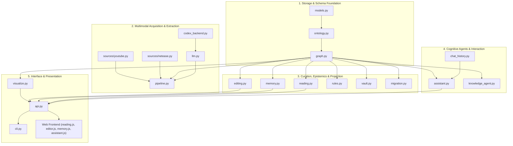

# OntoKB v2: Codebase Architecture & Function Catalog

**Documentation Suite**: OntoKB Technical Reference Manual  
**Version**: 2.0.0  
**Storage Directory**: `codebase_documentation/`  
**Target Repository**: `src/ontokb/` (20 Python modules, 4 Frontend Controllers)

---

## Executive Summary

OntoKB v2 is a local-first, schema-governed personal knowledge base and cognitive reading workspace. It continuously processes multimodal unstructured information (YouTube video transcripts, web articles, news), extracts structured entities and relational assertions compliant with a Schema.org profile, stores them in an ACID SQLite database, projects them into an Obsidian markdown vault with bidirectional links, and renders an interactive force-directed visual reading environment.

This technical documentation suite provides an exhaustive, function-by-function and class-by-class audit of the entire codebase. Every module, public method, private helper, decorator, and frontend controller is analyzed with signatures, parameter definitions, algorithmic workflows, side effects, and failure recovery mechanics.

---

## Master Document Navigation

The documentation is organized both as a monolithic reference manual and as specialized subsystem deep dives available in both GitHub Flavored Markdown (`.md`) and styled Microsoft Word (`.docx`) formats.

| Chapter / Subsystem | Primary Modules Covered | Focus & Key Concepts | Documentation Files |
| :--- | :--- | :--- | :--- |
| **⭐ 10-Minute Executive Primer** | Core Concepts & Architecture | High-level mental models, 2-tier invariant, schema governance, and system dataflow | [`CORE_CONCEPTS_10MIN_PRIMER.md`](file:///codebase_documentation/CORE_CONCEPTS_10MIN_PRIMER.md) `CORE_CONCEPTS_10MIN_PRIMER.docx` |
| **Complete Monolithic Reference** | All 24 Codebase Files | Unified reference covering every function across all subsystems | [`FULL_CODEBASE_FUNCTION_CATALOG.md`](file:///codebase_documentation/FULL_CODEBASE_FUNCTION_CATALOG.md) `FULL_CODEBASE_FUNCTION_CATALOG.docx` |
| **01. Core Models & Graph Store** | `models.py` `ontology.py` `graph.py` | Pydantic data schemas, Schema.org closed-world ontology validation, SQLite graph storage, NFKC normalization, CJK term variant expansion, transaction isolation. | [`01_CORE_MODELS_AND_GRAPH_STORE.md`](file:///codebase_documentation/01_CORE_MODELS_AND_GRAPH_STORE.md) `01_CORE_MODELS_AND_GRAPH_STORE.docx` |
| **02. Content Ingestion & Sources** | `sources/youtube.py` `sources/netease.py` `sources/__init__.py` | YouTube ID regex parsing, official caption downloading, `yt-dlp` audio extraction, local OpenAI Whisper STT fallback, WebVTT cleaning, Netease news scraping. | [`02_CONTENT_INGESTION_AND_SOURCES.md`](file:///codebase_documentation/02_CONTENT_INGESTION_AND_SOURCES.md) `02_CONTENT_INGESTION_AND_SOURCES.docx` |
| **03. Pipeline, LLM & Extraction** | `pipeline.py` `llm.py` `codex_backend.py` | Two-tier document graph generation, multi-provider LLM orchestration (OpenAI structured JSON, Anthropic tool-use, Codex CLI), strict schema compilation, automated backups. | [`03_PIPELINE_LLM_AND_EXTRACTION.md`](file:///codebase_documentation/03_PIPELINE_LLM_AND_EXTRACTION.md) `03_PIPELINE_LLM_AND_EXTRACTION.docx` |
| **04. Reading & Visualization** | `reading.py` `visualize.py` | Article categorization heuristics, reading library aggregation, guided summary step-walking dataset synthesis, standalone D3 HTML generator. | [`04_READING_VISUALIZATION_AND_EXPLORATION.md`](file:///codebase_documentation/04_READING_VISUALIZATION_AND_EXPLORATION.md) `04_READING_VISUALIZATION_AND_EXPLORATION.docx` |
| **05. Knowledge Curation & Memory** | `editing.py` `memory.py` | Optimistic concurrency revision hashing, entity renaming, alias mutation, edge curation, single-click undo journal, subjective stance management, comparative LLM memory synthesis. | [`05_KNOWLEDGE_CURATION_AND_EPISTEMIC_MEMORY.md`](file:///codebase_documentation/05_KNOWLEDGE_CURATION_AND_EPISTEMIC_MEMORY.md) `05_KNOWLEDGE_CURATION_AND_EPISTEMIC_MEMORY.docx` |
| **06. Assistant, Rules & Vault** | `assistant.py` `chat_history.py` `knowledge_agent.py` `rules.py` `vault.py` `migration.py` | Conversational grounding, multi-turn history bounds, autonomous ReAct agent with validated host tools, forward-chaining rule engine, Obsidian atomic file sync, schema migration. | [`06_ASSISTANT_AGENT_RULES_AND_PROJECTIONS.md`](file:///codebase_documentation/06_ASSISTANT_AGENT_RULES_AND_PROJECTIONS.md) `06_ASSISTANT_AGENT_RULES_AND_PROJECTIONS.docx` |
| **07. API Server & CLI** | `api.py` `cli.py` | HTTP/1.1 REST API server, Windows socket `SO_LINGER` protection, CORS verification, output flushing, CLI subcommands (`status`, `rules`, `queue`, `backfill`, `api`). | [`07_API_SERVER_AND_CLI.md`](file:///codebase_documentation/07_API_SERVER_AND_CLI.md) `07_API_SERVER_AND_CLI.docx` |
| **08. Web Frontend Controllers** | `web/reading.js` `web/editor.js` `web/memory.js` `web/assistant.js` | D3.js force simulation, smooth camera bounding-box animations, stepped walkthrough highlighting, modal forms, drawer panels, streaming chat bubbles. | [`08_WEB_FRONTEND_CONTROLLERS.md`](file:///codebase_documentation/08_WEB_FRONTEND_CONTROLLERS.md) `08_WEB_FRONTEND_CONTROLLERS.docx` |

---

## Architectural Layering Overview

---

## Key Repository Metrics

- **Total Python Modules**: 20 files
- **Total Frontend JavaScript Modules**: 4 files
- **Total Stylesheets & Templates**: 4 files (`reading.html`, `reading.css`, `editor.css`, `memory.css`)
- **Total Registered Ontology Classes**: 8 Schema.org classes (`Thing`, `CreativeWork`, `Article`, `VideoObject`, `Person`, `Organization`, `DefinedTerm`, `Claim`)
- **Total Controlled Predicates**: 14 semantic relations (`about`, `mentions`, `author`, `publisher`, `knows`, `worksFor`, `memberOf`, `alumniOf`, `parentOrganization`, `subOrganization`, `seeks`, `supports`, `refutes`, `sameAs`)
- **Database Engine**: SQLite 3 with WAL mode, JSON-1 extension, and transactional rollback isolation
- **Local Markdown Vault Target**: Obsidian-compatible directory hierarchy (`Sources/`, `Entities/`, `Wiki/`, `MOC/`, `Reports/`)
