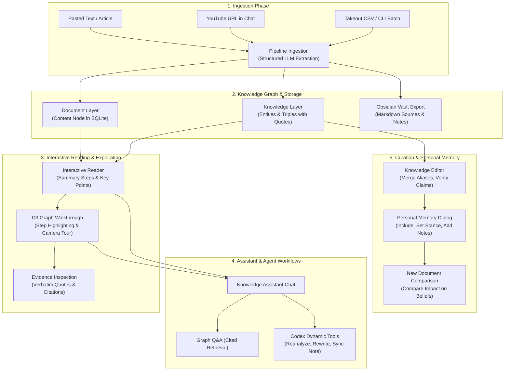
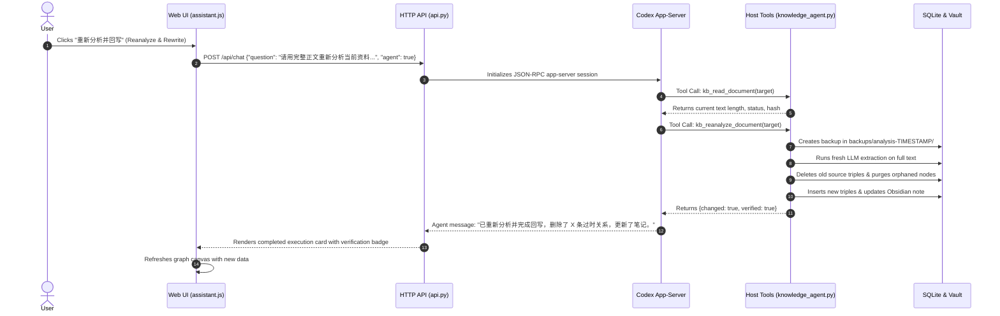
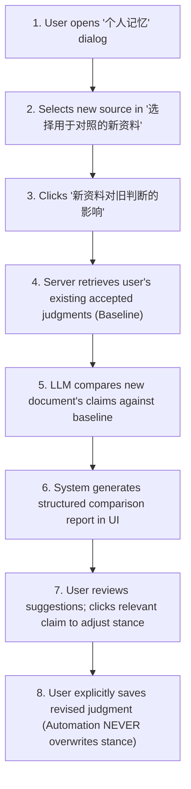

# ontoKB End-to-End User Process Flows

This document details the complete end-to-end process journeys that a user experiences when using **ontoKB**, from raw information capture to graph exploration, conversational assistance, and personal judgment curation.

---

## Process Overview Map

---

## Journey 1: Content Ingestion (Article & YouTube)

### 1.1 Ingesting a Web Article via the UI
1. **Trigger**: User clicks **`＋ 新建摘要`** in the top masthead.
2. **Input**: User fills out the modal form:
   * Title (e.g., *"Understanding Attention Mechanism in Transformers"*).
   * URL (optional, e.g., `https://arxiv.org/abs/1706.03762`).
   * Article Text (pastes 2,000–50,000 characters).
3. **Execution**: User clicks **`生成摘要并入库 ↗`**:
   * Frontend sends `POST /api/articles`.
   * Server creates a unique content ID (e.g., `hash:a1b2c3d4`).
   * Calls LLM (`llm.process_content`) using strict Pydantic schemas:
     * Generates a 3-paragraph summary.
     * Extracts 3–5 key takeaways.
     * Identifies topics and relevance scores.
     * Extracts typed entities (`Person`, `Organization`, `DefinedTerm`, `Claim`, `SoftwareApplication`).
     * Extracts triples with exact character evidence quotes.
   * `GraphStore` executes transaction:
     * Upserts `contents` record.
     * Normalizes entity names and matches existing aliases.
     * Writes `triples` with `source` attribution.
   * `Vault` generates formatted Markdown file at `vault/Sources/<title>.md`.
4. **Result**: The modal closes, the reader loads the new article, and the graph renders the newly extracted cluster.

### 1.2 Ingesting a YouTube Video via Chat
1. **Trigger**: User opens Assistant (`打开 Chat ↗`) and pastes a YouTube link:
   * *"分析 https://www.youtube.com/watch?v=XAujxrtd4uI 并入库"*
2. **Subtitles / Audio Extraction**:
   * Server identifies YouTube URL via regex.
   * Attempts to fetch official or auto-generated English/Chinese subtitles via `yt-dlp`.
   * **Fallback**: If subtitles are unavailable, downloads audio and invokes local `faster-whisper` speech-to-text to transcribe the audio track.
   * Caches raw transcript into `data/transcripts/youtube/<id>.json`.
3. **Knowledge Extraction & Storage**:
   * Transcripts are batched and handed to Codex / OpenAI structured output.
   * Writes nodes, links, and evidence quotes to SQLite.
   * Generates Obsidian note in `vault/Sources/`.
4. **Chat Response**:
   * Chat streams back the summary and highlights the newly created relations directly in the conversation drawer.

---

## Journey 2: Guided Reading & Graph Walkthrough

When reading dense technical articles or research reports, the user uses the synchronized **Reader + Graph Tour**:

1. **Selecting a Document**:
   * User selects an article from `#document-select`.
   * Left panel displays the summary broken into numbered steps (`01`, `02`, `03`...).
2. **Summary Step Walking**:
   * User clicks on Summary Step `02`:
     * That paragraph illuminates with an active highlight indicator.
     * The D3 graph camera smoothly pans and zooms to the specific entities extracted from that paragraph.
     * Non-participating nodes and edges fade to 15% opacity.
     * The Tour Dock at the bottom updates to step `02 / 05`.
3. **Automated Tour Playback**:
   * User clicks **`▶ 开始漫游`** in the Tour Dock.
   * The application automatically plays through the summary steps at the configured speed (6s, 10s, or 15s).
   * For each step, the graph animates its camera focus from concept to concept, visualizing the narrative flow of ideas.
4. **Inspecting Ground Truth Evidence**:
   * User sees an unexpected link in the graph (e.g., `Company A --[competesWith]--> Company B`).
   * User clicks the edge line on the SVG canvas.
   * The **Evidence Panel** opens, displaying:
     * Exact verbatim quote from the original source text.
     * Document title and timestamp.
     * Direct link to original source.

---

## Journey 3: Conversational Q&A & Codex Autonomous Assistant

ontoKB integrates an executable agent harness through the **Codex App-Server**:

### 3.1 Graph-Grounded Q&A
1. User types: *"What technologies does OpenAI use for reasoning models?"*
2. System performs hybrid retrieval:
   * Resolves query terms against the entity alias graph.
   * Fetches 1-hop and 2-hop triples from SQLite (`GraphStore.query_graph`).
3. LLM receives the grounded triples and answers with precise citations, preventing hallucinations.

### 3.2 Autonomous Maintenance via Host Tools
The agent is not just a passive chatbot; it has access to **5 registered host tools**:
* `kb_list_documents`: Scans the library.
* `kb_read_document`: Inspects raw transcripts, summaries, and Markdown notes to check for consistency.
* `kb_query_graph`: Performs graph searches.
* `kb_reanalyze_document`: Re-extracts full knowledge from source text and replaces obsolete triples.
* `kb_sync_note`: Rewrites the Obsidian vault note to reflect updated graph state.

#### Walkthrough of "Reanalyze and Rewrite":

---

## Journey 4: Knowledge Curation & Fact-Checking

When automated extraction introduces noise, wrong aliases, or disputed claims, the user uses the **Knowledge Editor**:

1. **Accessing the Editor**:
   * User clicks **`整理知识`** in the top navigation.
2. **Entity Deduplication & Alias Merging**:
   * User selects the **实体 (Entities)** tab.
   * Finds `"OpenAI Inc"`.
   * Changes the canonical name to `"OpenAI"`.
   * Adds `"OpenAI LP"`, `"ChatGPT maker"` into the Aliases box.
   * Clicks **`保存修改`**.
   * System merges aliases in SQLite (`aliases` table) so future queries for `"ChatGPT maker"` resolve to `"OpenAI"`.
3. **Verifying Disputed Claims**:
   * User selects the **论断 (Claims)** tab.
   * Finds claim: *"AGI will be achieved by the end of 2025"*.
   * Reviews the attached quote and source.
   * Changes `verificationStatus` from `待核实 (unverified)` to `有争议 (disputed)` or `已否定 (refuted)`.
   * Clicks **`保存修改`**.
4. **Auditing & Undo**:
   * User accidentally modifies a relation.
   * User clicks **`修改记录`** in the top-right of the editor.
   * A history log displays every mutation with before/after state diffs.
   * User clicks **`撤销 (Undo)`** on that action.
   * System executes the inverse mutation and restores the original record.

---

## Journey 5: Personal Memory & Stance Management

A key principle of ontoKB is that **storing a source's claim is not endorsing it**. Personal memory represents the user's subjective worldview.

1. **Opening Personal Memory**:
   * User clicks **`个人记忆`** in the top masthead.
2. **Reviewing Uncurated Knowledge**:
   * User sets Scope Filter to `未审核 (Unreviewed)`.
   * Selects an extracted Claim.
3. **Configuring Memory Stance**:
   * **Inclusion**: Sets `记忆范围` to `纳入个人记忆 (included: true)` (claim now becomes eligible for personal recall).
   * **Review**: Sets `审核状态` to `已审核 (reviewed: true)`.
   * **Stance**: Explicitly selects their personal position:
     * `认同 (agree)`: User agrees with the proposition.
     * `存疑 (uncertain)`: User remains skeptical or finds proof lacking.
     * `不认同 (disagree)`: User rejects the claim.
   * **Judgment Note**: User types their rationale: *"This holds true only under unconstrained compute assumptions."*
4. **Committing Changes**:
   * User clicks **`保存个人判断`**.
   * System commits record to `personal_memory`, increments `revision`, and appends an immutable entry to `memory_history`.

---

## Journey 6: Evaluating the Impact of New Knowledge on Beliefs

When a new source presents contradictory information or fresh evidence:

1. User selects a newly ingested whitepaper in `#memory-source`.
2. Clicks **`新资料对旧判断的影响`**.
3. Server executes `POST /api/memory/compare`:
   * Identifies overlapping entities and conflicting assertions.
   * Prompts the LLM with the established baseline judgments and the new claims.
   * LLM returns an analytical breakdown:
     * Claims in the new source that reinforce existing beliefs.
     * Claims that directly contradict existing beliefs.
     * Novel claims requiring user review.
4. **Safety Guarantee**: The report is purely advisory. The user must manually click through and update their stance if convinced.
