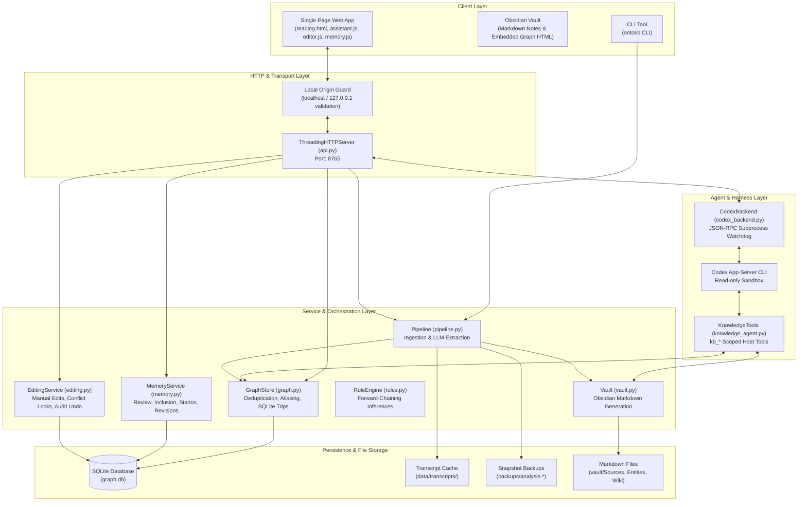

# ontoKB System Architecture, Data Models & Backend API Reference

This document provides a comprehensive technical reference for the internal architecture, service layer, data schemas, and the complete HTTP API specification of the **ontoKB** codebase, concluding with a gap analysis for upgrading to **ontoKBv2**.

---

## 1. System Architecture Overview



---

## 2. Core Python Services & Subsystems

### 2.1 `GraphStore` ([`src/ontokb/graph.py`](file:///c:/Users/jaiad/Personal_Work_Related/Third%20Wave%20Tech%20Training/Mini%20Project%20-%20ontoKB/ontoKBv2/ontoKBv2/ontoKB/src/ontokb/graph.py))
* **Role**: Primary data-access layer for entities, triples, and source metadata in SQLite.
* **Key Methods**:
  * `upsert_entity(entity: ExtractedEntity, source: str) -> int`: Normalizes entity names (NFKC + lowercase), resolves existing aliases, and inserts or updates the entity row.
  * `add_triple(triple: ExtractedTriple, ontology, source: str) -> int`: Validates triple against ontology relation domains/ranges and inserts edge with evidence quote.
  * `query_graph(terms: list[str], mode: str, expand: bool, top_k: int)`: Executes 1-hop subgraph search matching subject, predicate, or object.
  * `resolve_aliases(name: str) -> str`: Maps any known alias back to canonical entity name.

### 2.2 `MemoryService` ([`src/ontokb/memory.py`](file:///c:/Users/jaiad/Personal_Work_Related/Third%20Wave%20Tech%20Training/Mini%20Project%20-%20ontoKB/ontoKBv2/ontoKBv2/ontoKB/src/ontokb/memory.py))
* **Role**: Manages subjective user curation, personal memory inclusion, and stance evolution.
* **Key Methods**:
  * `targets() -> dict`: Scans all SQLite entities and triples, generating a deterministic SHA-256 identity key for each item:
    $$\text{key} = \text{SHA256}(\text{kind}, \text{subject}, \text{predicate}, \text{object}, \text{source}, \text{evidence})$$
  * `bootstrap() -> dict`: Returns all active records, judgment history, and source inventory.
  * `update(payload: dict) -> dict`: Optimistic concurrency update verifying `expected_revision`. Appends changes to `memory_history`.
  * `compare(source_id: str) -> dict`: Evaluates the impact of new claims against established personal memory without mutating stances.

### 2.3 `EditingService` ([`src/ontokb/editing.py`](file:///c:/Users/jaiad/Personal_Work_Related/Third%20Wave%20Tech%20Training/Mini%20Project%20-%20ontoKB/ontoKBv2/ontoKBv2/ontoKB/src/ontokb/editing.py))
* **Role**: Curates entities and relations; prevents automated extraction from overwriting manual user corrections.
* **Key Methods**:
  * `update_entity(entity_id, updates)`: Modifies canonical name, aliases, or verification status.
  * `update_triple(triple_id, updates)`: Re-links triple endpoints or modifies confidence.
  * `delete_triple(triple_id)`: Flags triple as soft-deleted in `manual_triples`.
  * `undo(history_id)`: Reverses a prior mutation by restoring the recorded `before_state`.

### 2.4 `KnowledgeTools` ([`src/ontokb/knowledge_agent.py`](file:///c:/Users/jaiad/Personal_Work_Related/Third%20Wave%20Tech%20Training/Mini%20Project%20-%20ontoKB/ontoKBv2/ontoKBv2/ontoKB/src/ontokb/knowledge_agent.py))
* **Role**: Host-side tool registry exposed to the Codex app-server agent.
* **Registered Tools**:
  1. `kb_list_documents`: Returns saved content IDs, titles, and sources.
  2. `kb_read_document(target)`: Reads summary, notes, transcript, and verifies analysis currency.
  3. `kb_query_graph(query)`: Searches facts across the knowledge graph.
  4. `kb_reanalyze_document(target)`: Forces re-extraction from raw text, creates timestamped backups, rewrites triples, and updates notes.
  5. `kb_sync_note(target)`: Syncs Obsidian note from current graph state without re-extracting.

---

## 3. Complete HTTP API Specification

Base Server URL: `http://127.0.0.1:8765`

### 3.1 System & Exploration Endpoints

#### `GET /`
* **Description**: Renders the complete dynamic single-page application (`reading.html` populated with D3.js graph data, assistant, editor, and memory components).
* **Response**: `200 OK` (HTML with `Content-Type: text/html; charset=utf-8`, `Cache-Control: no-store`).

#### `GET /health`
* **Description**: Diagnostic health check and feature capabilities.
* **Response `200 OK`**:
  ```json
  {
    "ok": true,
    "app_id": "ontokb",
    "ui_version": "reading-v1",
    "features": {
      "article_summary": true,
      "summary_walk": true,
      "transcript_validation": true,
      "chat_history": true,
      "knowledge_tools": true,
      "knowledge_editor": true,
      "personal_memory": true,
      "judgment_comparison": true
    },
    "chat": true,
    "llm_provider": "codex",
    "llm_configured": true
  }
  ```

#### `GET /api/reading`
* **Description**: Fetches graph data, articles, categories, and reading steps for the workbench.
* **Response `200 OK`**:
  ```json
  {
    "nodes": [{"id": "e1", "name": "OpenAI", "type": "Organization"}],
    "links": [{"source": "e1", "target": "e2", "predicate": "develops", "evidence": "..."}],
    "library": [{
      "id": "art:1",
      "title": "OpenAI o1",
      "categories": ["AI"],
      "steps": [{"step": 1, "text": "...", "entities": ["OpenAI"]}],
      "key_points": ["..."]
    }]
  }
  ```

#### `GET /api/entities/search`
* **Query Parameters**:
  * `q` (string, required): Search query.
  * `mode` (string): `terms` (default) or `phrase`.
  * `expand` (int): `1` (expand aliases) or `0`.
  * `limit` (int): Max results (default 50).
* **Response `200 OK`**: JSON array of matching entity objects.

#### `GET /api/graph/query`
* **Query Parameters**:
  * `q` (string, required): Query keyword or entity name.
  * `format` (string): `json` (default) or `table` (formatted text table).
* **Response `200 OK`**: Returns matching triples and connected 1-hop subgraph.

---

### 3.2 Ingestion & Document Mutation Endpoints

#### `POST /api/articles`
* **Description**: Ingests pasted raw article text, runs LLM structured extraction, writes to SQLite, and generates an Obsidian Markdown note.
* **Headers**: `Content-Type: application/json`
* **Request Body**:
  ```json
  {
    "title": "Understanding Transformers",
    "text": "Full article text (min 20 chars, max 100,000 chars)...",
    "url": "https://arxiv.org/abs/1706.03762"
  }
  ```
* **Response `200 OK`**:
  ```json
  {
    "content_id": "art:e8b4f2c9",
    "title": "Understanding Transformers",
    "nodes_added": 12,
    "triples_added": 18
  }
  ```

#### `POST /api/reading/category`
* **Description**: Assigns or modifies categories on a document.
* **Request Body**:
  ```json
  {
    "content_id": "art:e8b4f2c9",
    "category": "Deep Learning"
  }
  ```
* **Response `200 OK`**: `{"content_id": "art:e8b4f2c9", "categories": ["Deep Learning"]}`

---

### 3.3 Conversational Agent Endpoint

#### `POST /api/chat`
* **Description**: Multi-turn conversational interface with graph retrieval and dynamic tool execution.
* **Request Body**:
  ```json
  {
    "question": "What algorithms does o1 use?",
    "agent": true,
    "content_id": "art:e8b4f2c9",
    "history": [
      {"role": "user", "content": "Tell me about o1"},
      {"role": "assistant", "content": "OpenAI o1 is..."}
    ],
    "mode": "terms",
    "expand": true,
    "top": 20
  }
  ```
* **Response `200 OK`**:
  ```json
  {
    "answer": "o1 employs reinforcement learning to optimize chain-of-thought...",
    "tool_operations": [
      {"tool": "kb_query_graph", "success": true, "result": "..."}
    ]
  }
  ```

---

### 3.4 Knowledge Editor & Curation Endpoints

#### `GET /api/editor`
* **Description**: Returns all entities, claims, triples, sources, and edit history for the curator modal.

#### `POST /api/editor/entity`
* **Description**: Updates entity canonical name, aliases, or verification status.
* **Request Body**:
  ```json
  {
    "id": 42,
    "name": "OpenAI",
    "type": "Organization",
    "aliases": ["OpenAI Inc", "OpenAI LP"],
    "verificationStatus": "verified"
  }
  ```

#### `POST /api/editor/triple`
* **Description**: Updates triple endpoints, predicate, or confidence score.
* **Request Body**:
  ```json
  {
    "id": 105,
    "subject_id": 42,
    "predicate": "develops",
    "object_id": 88,
    "confidence": 0.95
  }
  ```

#### `POST /api/editor/history/undo`
* **Description**: Reverts a mutation by history ID.
* **Request Body**: `{"id": 12}`

---

### 3.5 Personal Memory Endpoints

#### `GET /api/memory`
* **Description**: Returns all personal memory records, snapshots, and judgment history.

#### `POST /api/memory/review`
* **Description**: Updates personal memory inclusion, review state, stance, and rationale.
* **Request Body**:
  ```json
  {
    "key": "3f8b82e4...",
    "revision": 2,
    "reviewed": true,
    "included": true,
    "stance": "agree",
    "note": "Validated against empirical benchmarks",
    "source_id": "art:e8b4f2c9"
  }
  ```
* **Response `200 OK`**:
  ```json
  {
    "key": "3f8b82e4...",
    "revision": 3,
    "changed": true
  }
  ```

#### `POST /api/memory/compare`
* **Description**: LLM comparison of a new document against established personal judgments.
* **Request Body**: `{"source_id": "art:e8b4f2c9"}`
* **Response `200 OK`**:
  ```json
  {
    "answer": "Detailed analysis of contradictions and confirmations...",
    "scope": "Compared against 8 included personal judgments",
    "baseline": [...]
  }
  ```

---

## 4. Gap Analysis: Upgrading from ontoKB (v1) to ontoKBv2

Comparing this codebase to the target 10-day requirements in [`PROJECT_REQUIREMENTS_V2_EN.md`](file:///c:/Users/jaiad/Personal_Work_Related/Third%20Wave%20Tech%20Training/Mini%20Project%20-%20ontoKB/ontoKBv2/ontoKBv2/docs/PROJECT_REQUIREMENTS_V2_EN.md):

| Feature Area | Existing ontoKB Implementation | ontoKBv2 Target Requirement | Action Needed for v2 |
|---|---|---|---|
| **Type System** | Dynamic Schema.org profile (`Thing`, `Person`, etc.) in YAML with loose dictionary properties. | **6 Fixed Visible Types**: `SourceDocument`, `Person`, `Organization`, `Concept`, `Claim`, `PersonalMemory`. | Replace dynamic schema checks with explicit class models enforcing typed properties and character span bounds. |
| **Action Execution** | Ad-hoc Python functions (`ingest_article`, `update_entity`, `save_review`). | **4 Executable Action Types**: `CaptureSource`, `AcceptMemory`, `ReviseJudgment`, `ExcludeMemory`. | Formalize Action contracts with typed inputs, revision concurrency checks, and idempotency protection. |
| **Audit & Receipts** | Basic `edit_history` table recording raw JSON diffs. | **Durable Audit Receipts**: Every Action emits an immutable cryptographic receipt with normalized payload hashes. | Implement durable receipt generator and state outbox for process crash recovery. |
| **Recall Isolation** | Single query interface searching the entire graph. | **Dual-Scope Recall**: Strict separation between "source library" citations and "my memory" assertions. | Implement scoped retrieval queries: Source answers attribute claims; Memory answers use only owner-included records with stance. |
| **Codex Harness** | Spawns fresh subprocess per request, caps at 8 calls. | **Harden Harness Boundary**: Bounded timeouts, durable run IDs, restart reconciliation, and receipt verification before claiming success. | Refactor `codex_backend.py` to persist run states outside conversation threads and handle process crashes gracefully. |
