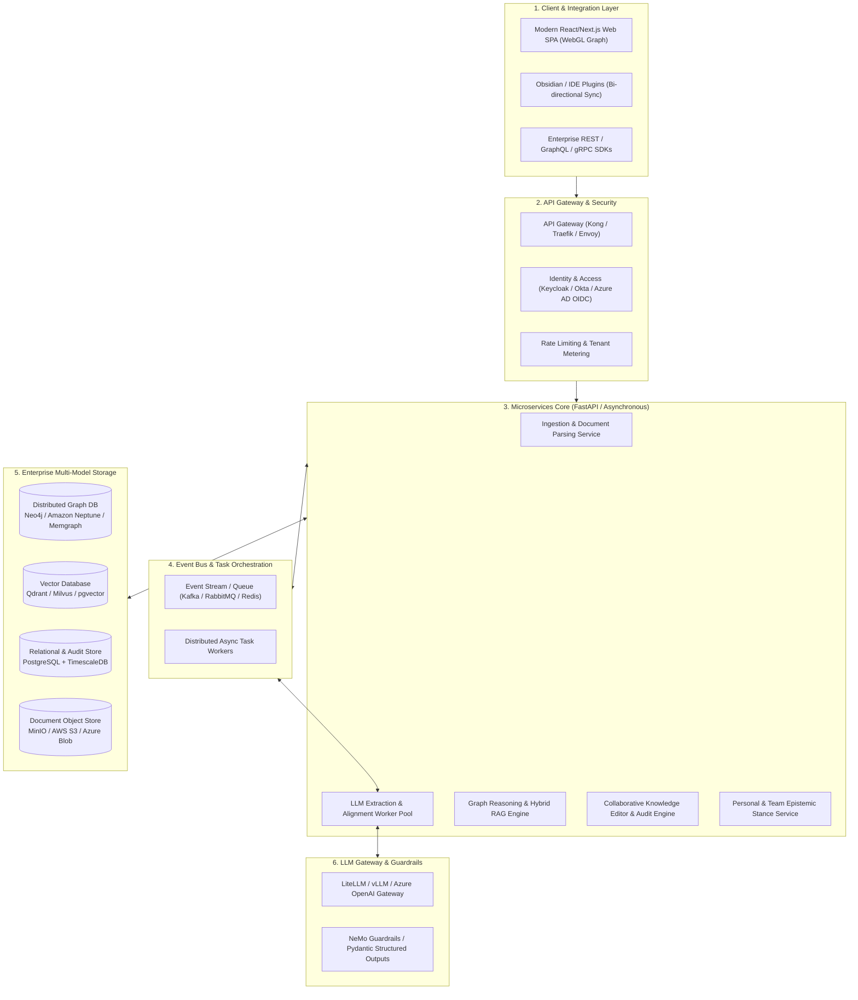
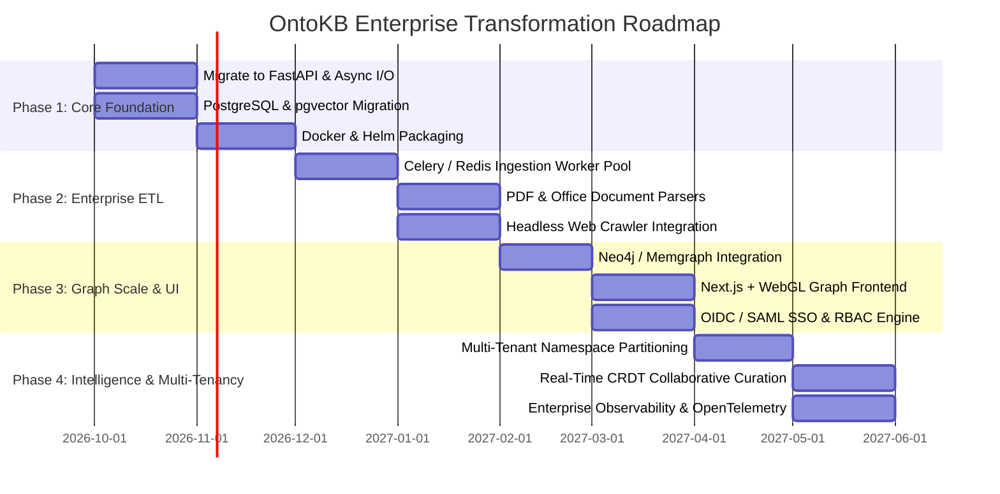

# OntoKB v2: Enterprise-Grade Transformation Roadmap & Architecture

**Document Identifier**: ONTOKB-DOC-07  
**Version**: 2.0.0  
**Date**: September 2026  
**Status**: Strategic Engineering Blueprint & Transformation Plan  

---

## 1. Executive Vision: From Prototype to Enterprise Semantic Platform

The future of enterprise AI lies in **Neurosymbolic Knowledge Systems**—uniting the generative reasoning capabilities of Large Language Models (LLMs) with the deterministic precision, auditability, and governance of Formal Knowledge Graphs.

**OntoKB Enterprise (OntoKB-E)** transforms the current personal prototype into a high-throughput, multi-tenant, cloud-native Knowledge Intelligence Platform. It provides enterprise organizations with:
- **Zero-Hallucination Enterprise RAG**: Graph-grounded responses citing verified corporate entities and verbatim receipts.
- **Continuous Corporate Knowledge Capture**: Automated ingestion across enterprise data silos (SharePoint, Confluence, Slack, Google Drive, Jira, PDFs).
- **Collaborative Knowledge Curation**: Multi-user, role-based entity verification workflows with audit logging.
- **Enterprise-Scale Hybrid Search**: Sub-second graph traversals across millions of nodes combined with vector similarity search.

---

## 2. Target Enterprise Architecture Blueprint

---

## 3. Core Enterprise Subsystem Specifications

### 3.1 Distributed Multi-Model Storage Engine
Instead of relying on a single SQLite file, OntoKB Enterprise adopts a **polyglot persistence model**:
1. **Graph Database (Neo4j / Memgraph / Amazon Neptune)**:
   - Stores the core Schema.org Knowledge Tier and Document Tier.
   - Provides native Cypher/openCypher query execution with index-free adjacency.
   - Capable of 10-hop graph traversal queries in $< 15\text{ms}$ across billions of edges.
2. **Vector Database (Qdrant / Milvus / pgvector)**:
   - Stores dense embeddings (e.g. OpenAI `text-embedding-3-large`, BGE-M3, or Cohere Embed v3) for documents, entity descriptions, and verbatim evidence quotes.
   - Powers hybrid retrieval: $\text{Score} = \alpha \cdot \text{VectorSimilarity} + \beta \cdot \text{BM25} + \gamma \cdot \text{GraphPageRank}$.
3. **Relational & Event Store (PostgreSQL + TimescaleDB)**:
   - Stores user authentication, tenant metadata, role permissions, and immutable audit logs (`edit_history`, `memory_history`).
   - Enables Point-in-Time Recovery (PITR) and compliance rollback journals.
4. **Object Storage (MinIO / S3)**:
   - Stores raw original files (PDFs, recordings, audio files, image scans) with cryptographic hash integrity checks.

### 3.2 Enterprise ETL & Ingestion Subsystem
- **Automated Web Article Crawler**:
  - Headless browser pool (Playwright / Crawl4AI) equipped to bypass dynamic JavaScript hydration, cookie banners, and bot protections.
  - Readability extraction using Trafilatura to isolate high-quality text, author metadata, and publication timestamps.
- **Enterprise File Parsers**:
  - Deep document layout analysis (e.g., Unstructured.io, Marker, or Microsoft Azure Form Recognizer) for multi-column academic papers, contracts, tables, and presentation slide decks.
- **SaaS Connectors**:
  - Pre-built sync connectors for Google Drive, Microsoft SharePoint, Notion, Atlassian Confluence, Jira, and Slack.
  - Incremental webhook change data capture (CDC) to trigger delta extractions automatically when corporate wikis are updated.

### 3.3 High-Throughput LLM Gateway & Guardrails
- **Structured Decoding Enforcement**:
  - Adopts Pydantic / Outlines / OpenAI JSON Schema validation to guarantee that LLM extraction completions strictly conform to the YAML ontology profile without syntax or type errors.
- **Dynamic Model Routing & Fallback**:
  - Fast, inexpensive models (e.g. Claude 3.5 Haiku / GPT-4o-mini / Llama-3.1-8B) for initial NER and text filtering.
  - Frontier reasoning models (Claude 3.5 Sonnet / GPT-4o / o1) for complex multi-relation extraction, stance comparison, and contradiction detection.
- **Entity Resolution & Disambiguation (NERD)**:
  - Vector similarity search against existing graph entities combined with cross-encoder re-ranking.
  - Disambiguates homonyms using document context and links entities to external registries (Wikidata, SEC EDGAR, Crunchbase).

### 3.4 Modern WebGL Graph Frontend (Next.js & React 19)
- **High-Performance Rendering**:
  - Replaces SVG DOM-based D3 with **WebGL / WebGPU-accelerated graph rendering** (using libraries such as PixiJS, Cytoscape.js WebGL, or Cosmos / 3D-Force-Graph).
  - Effortlessly visualizes **100,000+ nodes and edges** at a locked 60 frames per second.
- **State Management & Collaborative Editing**:
  - Zustand or TanStack Query for reactive client-side caching.
  - Multi-user real-time collaborative curation powered by Yjs / CRDTs (Conflict-free Replicated Data Types) and WebSockets.

---

## 4. Enterprise Security, Governance & Compliance

| Security Requirement | Implementation Strategy in OntoKB Enterprise |
| :--- | :--- |
| **Authentication & SSO** | OpenID Connect (OIDC) & SAML 2.0 integration with Okta, Microsoft Entra ID (Azure AD), Google Workspace, and Ping Identity. |
| **Role-Based Access (RBAC)**| Granular roles: `Viewer` (chat/query only), `Contributor` (submit articles), `Curator` (edit entities/relations), `Ontologist` (modify core schema), `Admin` (tenant management). |
| **Multi-Tenancy** | Physical or logical schema partitioning per enterprise organization; cross-tenant data leakage mathematically prevented via tenant-keyed query decorators. |
| **Attribute-Based Access (ABAC)** | Sensitivity labels on documents (e.g. `Confidential`, `Internal`, `Public`); subgraphs inherit document security classifications, redacting unauthorized nodes from search results. |
| **Data Encryption** | Envelope encryption with AES-256 for all databases and object storage; TLS 1.3 for all in-transit communications. Customer-Managed Encryption Keys (CMEK) via AWS KMS or HashiCorp Vault. |
| **Regulatory Compliance** | Full audit trail supporting SOC2 Type II, ISO 27001, GDPR "Right to be Forgotten" (cascade entity redaction), and HIPAA Business Associate Agreement readiness. |

---

## 5. Phased Implementation Roadmap

### Detailed Phase Breakdown

#### Phase 1: Architecture Modernization & Reliability (Months 1–2)
- **Goal**: Eliminate single-file database locks and server crashes.
- **Key Tasks**:
  1. Replace `ThreadingHTTPServer` with asynchronous **FastAPI** running on Uvicorn.
  2. Migrate SQLite storage to **PostgreSQL** with connection pooling (`pgbouncer`).
  3. Integrate `pgvector` to enable baseline semantic vector search.
  4. Containerize the entire system with Docker and Docker Compose.

#### Phase 2: Enterprise ETL & Scalable Ingestion (Months 3–4)
- **Goal**: Ingest any document format asynchronously without blocking user requests.
- **Key Tasks**:
  1. Implement Celery / Redis task queue to decouple ingestion from the web API.
  2. Build document parsers for PDF, DOCX, PPTX, and HTML using Marker and Trafilatura.
  3. Integrate Playwright for automated web article link crawling.
  4. Connect LiteLLM gateway with structured Pydantic extraction schemas.

#### Phase 3: High-Performance Graph & Modern UI (Months 5–6)
- **Goal**: Support 100,000+ nodes and enterprise security.
- **Key Tasks**:
  1. Implement a storage adapter for **Neo4j / Memgraph** for deep multi-hop graph queries.
  2. Rewrite the frontend in **Next.js / React 19** with a WebGL/PixiJS graph renderer.
  3. Implement OIDC/SAML single sign-on and role-based access control.

#### Phase 4: Multi-Tenancy, Collaboration & Governance (Months 7–8)
- **Goal**: Full enterprise-ready deployment with team collaboration.
- **Key Tasks**:
  1. Multi-tenant logical isolation and workspace management.
  2. Real-time collaborative curation via WebSockets and CRDTs.
  3. Complete OpenTelemetry tracing, Prometheus metrics, and SOC2 audit compliance.
